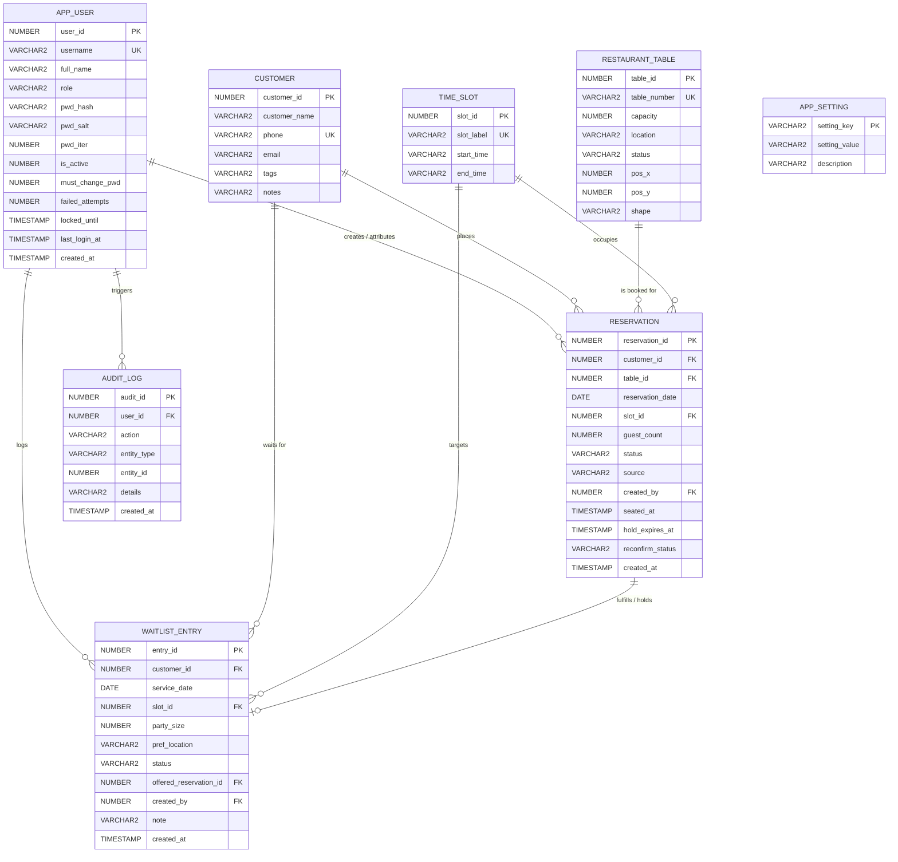
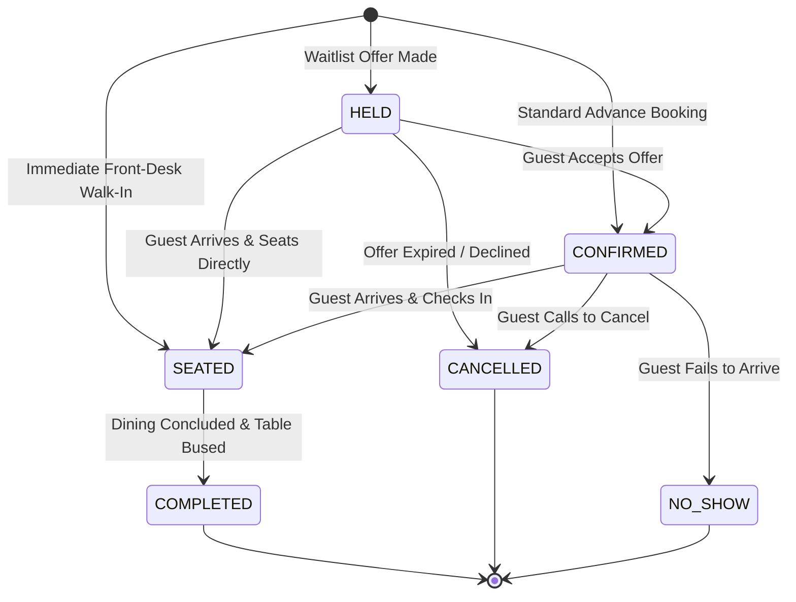
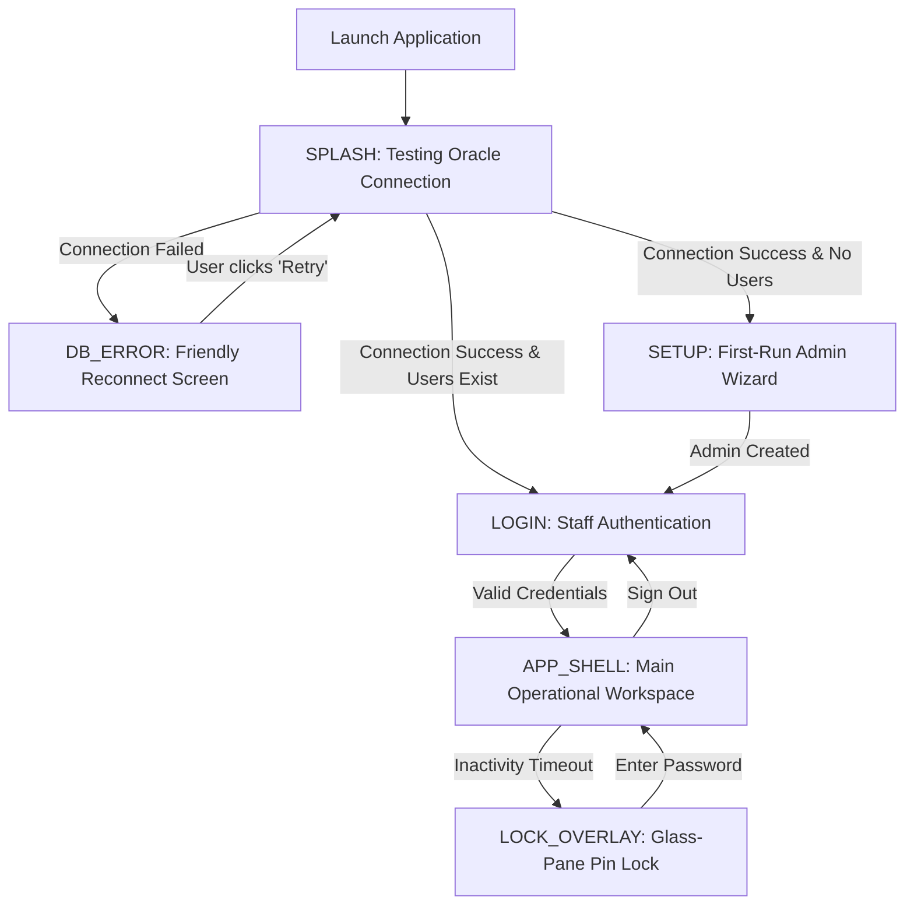

# Restaurant Table Reservation System (RTRS) — Comprehensive Codebase Master Guide

> **Target Audience:** Developers, Students, System Architects, Evaluators, and Viva Voce Examiners.  
> **Document Purpose:** An all-inclusive, authoritative, and easily understandable master document explaining the architecture, database mechanics, security protocols, algorithms, user interface, and operational workflows of the **Restaurant Table Reservation System (RTRS)**.  
> **Course Alignment:** Object-Oriented Programming Using Java and Database Technology Laboratory (Project 13).  
> **Root Codebase Path:** `d:\Desktop\project\RTRS`

---

## Table of Contents

1. [Executive Summary & The Layman's Primer](#1-executive-summary--the-laymans-primer)
   - [1.1 What is RTRS?](#11-what-is-rtrs)
   - [1.2 The Real-World Restaurant Problem (Why Spreadsheets Fail)](#12-the-real-world-restaurant-problem-why-spreadsheets-fail)
   - [1.3 The Three Pillars of RTRS](#13-the-three-pillars-of-rtrs)
   - [1.4 Technology Stack & Prerequisites](#14-technology-stack--prerequisites)
   - [1.5 Non-Negotiable Engineering Constraints](#15-non-negotiable-engineering-constraints)
2. [High-Level System Architecture](#2-high-level-system-architecture)
   - [2.1 Multi-Tier Layered Architecture](#21-multi-tier-layered-architecture)
   - [2.2 Strict Architectural Rules & Boundaries](#22-strict-architectural-rules--boundaries)
   - [2.3 Threading Model & UI Responsiveness (`Ui.async`)](#23-threading-model--ui-responsiveness-uiasync)
   - [2.4 Database Clock Synchronization (`DbClock`)](#24-database-clock-synchronization-dbclock)
   - [2.5 Logging & Diagnostics (`AppLog`)](#25-logging--diagnostics-applog)
3. [Object-Oriented Programming (OOP) Showcase](#3-object-oriented-programming-oop-showcase)
   - [3.1 Encapsulation & Domain Invariants](#31-encapsulation--domain-invariants)
   - [3.2 Polymorphism & Generics (`CrudDAO<T, ID>`)](#32-polymorphism--generics-cruddaot-id)
   - [3.3 Inheritance Hierarchy (`AppException` & `BasePanel`)](#33-inheritance-hierarchy-appexception--basepanel)
   - [3.4 Composition & Loose Coupling](#34-composition--loose-coupling)
   - [3.5 Enterprise Design Patterns in Action](#35-enterprise-design-patterns-in-action)
4. [Oracle Database Engine & Concurrency Mechanics](#4-oracle-database-engine--concurrency-mechanics)
   - [4.1 Why Oracle Database? (The Bank Vault Analogy)](#41-why-oracle-database-the-bank-vault-analogy)
   - [4.2 Relational Schema & Entity-Relationship Model](#42-relational-schema--entity-relationship-model)
   - [4.3 Exhaustive Table Dictionary](#43-exhaustive-table-dictionary)
   - [4.4 The Double-Booking Prevention Secret (`UQ_ACTIVE_BOOKING`)](#44-the-double-booking-prevention-secret-uq_active_booking)
   - [4.5 Pessimistic Locking (`SELECT ... FOR UPDATE`)](#45-pessimistic-locking-select--for-update)
   - [4.6 Database Triggers & Business Enforcements](#46-database-triggers--business-enforcements)
   - [4.7 Database Normalization Derivation (1NF → BCNF)](#47-database-normalization-derivation-1nf--bcnf)
   - [4.8 Oracle Error Code Translation (`OracleErrorMapper`)](#48-oracle-error-code-translation-oracleerrormapper)
5. [Security, Authentication & Role-Based Access Control (RBAC)](#5-security-authentication--role-based-access-control-rbac)
   - [5.1 Cryptographic Password Security (PBKDF2-HMAC-SHA256)](#51-cryptographic-password-security-pbkdf2-hmac-sha256)
   - [5.2 Protection Against Timing Attacks](#52-protection-against-timing-attacks)
   - [5.3 Brute-Force Defense & Database-Backed Lockout](#53-brute-force-defense--database-backed-lockout)
   - [5.4 Role & Permission Matrix (`MANAGER` vs `HOST`)](#54-role--permission-matrix-manager-vs-host)
   - [5.5 Session Lifecycle & Idle Screen Lock (`IdleLockMonitor`)](#55-session-lifecycle--idle-screen-lock-idlelockmonitor)
   - [5.6 First-Run Self-Provisioning Setup Wizard](#56-first-run-self-provisioning-setup-wizard)
6. [Core Business Logic & Intelligent Automation](#6-core-business-logic--intelligent-automation)
   - [6.1 Best-Fit Table Recommendation Algorithm](#61-best-fit-table-recommendation-algorithm)
   - [6.2 6-State Reservation Lifecycle State Machine](#62-6-state-reservation-lifecycle-state-machine)
   - [6.3 The Autonomous Slot Recovery Loop](#63-the-autonomous-slot-recovery-loop)
   - [6.4 Waitlist Candidate Offer Policies (`BestFit` vs `FIFO`)](#64-waitlist-candidate-offer-policies-bestfit-vs-fifo)
   - [6.5 Front-Desk Rapid Walk-In Seating](#65-front-desk-rapid-walk-in-seating)
   - [6.6 Customer Attendance Reconfirmation Engine](#66-customer-attendance-reconfirmation-engine)
7. [The Presentation Layer & UI Architecture](#7-the-presentation-layer--ui-architecture)
   - [7.1 Look and Feel: Modern FlatLaf & Inter Typography](#71-look-and-feel-modern-flatlaf--inter-typography)
   - [7.2 Design Token System (`Theme.java`)](#72-design-token-system-themejava)
   - [7.3 Application Shell & 3-State Root Architecture (`MainFrame`)](#73-application-shell--3-state-root-architecture-mainframe)
   - [7.4 Navigation Sidebar & Screen Routing](#74-navigation-sidebar--screen-routing)
   - [7.5 Tour of the 10 Primary System Panels](#75-tour-of-the-10-primary-system-panels)
   - [7.6 Custom `Graphics2D` Vector-Painted Components](#76-custom-graphics2d-vector-painted-components)
8. [Step-by-Step Operational Walkthroughs (Layman Scenarios)](#8-step-by-step-operational-walkthroughs-layman-scenarios)
   - [8.1 Scenario A: Reserving a Table for Tomorrow Evening](#81-scenario-a-reserving-a-table-for-tomorrow-evening)
   - [8.2 Scenario B: Welcoming & Seating an Arriving Guest](#82-scenario-b-welcoming--seating-an-arriving-guest)
   - [8.3 Scenario C: Cancellation & Instant Waitlist Refill](#83-scenario-c-cancellation--instant-waitlist-refill)
   - [8.4 Scenario D: Managing Walk-Ins on a Busy Weekend](#84-scenario-d-managing-walk-ins-on-a-busy-weekend)
   - [8.5 Scenario E: Adding New Staff & Resetting Passwords](#85-scenario-e-adding-new-staff--resetting-passwords)
   - [8.6 Scenario F: Generating Reports & Exporting to CSV](#86-scenario-f-generating-reports--exporting-to-csv)
9. [Testing Verification & Quality Assurance Guide](#9-testing-verification--quality-assurance-guide)
   - [9.1 Automated Unit Tests (JUnit 5 Suite)](#91-automated-unit-tests-junit-5-suite)
   - [9.2 15 End-to-End System Verification Scenarios](#92-15-end-to-end-system-verification-scenarios)
   - [9.3 Proving Double-Booking Prevention via SQL Demonstration](#93-proving-double-booking-prevention-via-sql-demonstration)
   - [9.4 Comprehensive Viva Voce Defense Q&A](#94-comprehensive-viva-voce-defense-qa)
10. [Exhaustive Codebase File & Package Catalog](#10-exhaustive-codebase-file--package-catalog)

---

## 1. Executive Summary & The Layman's Primer

### 1.1 What is RTRS?
The **Restaurant Table Reservation System (RTRS)** is an enterprise-grade standalone desktop application built in modern Java Swing and connected directly through Java Database Connectivity (JDBC) to an **Oracle Database XE** relational engine.

It is designed for modern, high-volume dining establishments (bistros, fine dining venues, and luxury banquet restaurants) to manage customer profiles, dining table inventory, seating schedules, live front-of-house operations, and business intelligence reports.

---

### 1.2 The Real-World Restaurant Problem (Why Spreadsheets Fail)

Imagine a popular, bustling restaurant on a Saturday evening. Managing bookings using a physical diary, an Excel spreadsheet, or a simplistic software program leads to four operational catastrophes:

1. **The Double-Booking Nightmare:** Two receptionists answer two different phone calls at 7:00 PM. Both cashiers book "Table 4" for 8:00 PM for different families. Both families show up at 8:00 PM expecting a warm dinner. One family has to be turned away in embarrassment.
2. **Seat Wastage (The 2-in-an-8 Dilemma):** A couple walks in requesting a table. A careless host seats them at an 8-person banquet table because "it was free." Ten minutes later, a family of 7 walks in and cannot be seated because the 8-seater has two people sitting at it. Revenue is permanently lost.
3. **Empty Tables from No-Shows & Last-Minute Cancellations:** A customer cancels their 8:30 PM reservation at 8:15 PM. Meanwhile, 10 hopeful patrons are waiting in the lobby or outside on the street. By the time staff notice the table is free, the time slot is half over, leaving prime restaurant capacity completely unmonetized.
4. **Security & Human Error:** Junior staff can accidentally delete past records, see sensitive management metrics, or overwrite other people's reservations. When something goes wrong, nobody knows who made the change.

---

### 1.3 The Three Pillars of RTRS

To solve these real-world challenges, RTRS is built upon three foundational engineering pillars:

```
┌─────────────────────────────────────────────────────────────────────────────┐
│                       THE THREE PILLARS OF RTRS                             │
├──────────────────────┬──────────────────────┬───────────────────────────────┤
│ 1. Engine-Level      │ 2. Intelligent Auto- │ 3. Luxury Front-of-House      │
│    Double-Booking    │    mation & Slot     │    Interactive User           │
│    Prevention        │    Recovery          │    Experience                 │
├──────────────────────┼──────────────────────┼───────────────────────────────┤
│ Oracle Database      │ Pure greedy best-fit │ Modern FlatLaf theme, 2D      │
│ itself rejects con-  │ table algorithm pre- │ vector floor plan editor with │
│ flicts via a func-   │ vents seat wastage.  │ chair dots, live dining timer │
│ tion-based unique    │ Automated waitlist   │ countdowns, non-blocking      │
│ index and row-level  │ refill loop fills    │ toast alerts, and 360 guest   │
│ pessimistic locks.   │ cancelled slots.     │ and staff profiles.           │
└──────────────────────┴──────────────────────┴───────────────────────────────┘
```

---

### 1.4 Technology Stack & Prerequisites

- **Language Runtime:** Java Development Kit 21 (JDK 21 LTS).
- **Presentation Framework:** Java Swing (`javax.swing.*`) + Java AWT (`java.awt.*`, `Graphics2D`).
- **Look and Feel Engine:** [FlatLaf 3.5.4](file:///d:/Desktop/project/RTRS/pom.xml) + [FlatInterFont 4.0](file:///d:/Desktop/project/RTRS/pom.xml) (Inter typography).
- **Database Engine:** Oracle Database Express Edition (tested across XE 11g, 18c, and 21c).
- **Connectivity:** Oracle JDBC Thin Driver (`ojdbc8:21.9.0.0`).
- **Build & Dependency Management:** Apache Maven 3.8+.
- **Packaging:** Maven Shade Plugin (`maven-shade-plugin:3.5.2`) generating a self-contained executable Fat JAR (`target/rtrs.jar`).
- **Quality Assurance:** JUnit 5 (`junit-jupiter:5.10.2`).

---

### 1.5 Non-Negotiable Engineering Constraints

This project was built to satisfy the rigorous criteria of **Project 13: Object-Oriented Programming Using Java and Database Technology Laboratory**:

1. **No Web Frameworks:** Zero React, Angular, Vue, HTML, CSS, or Node.js. It is a true native desktop application.
2. **No Enterprise Magic (No Spring Boot, No Jakarta EE):** All object instantiation, dependency wiring, threading, and lifecycle events are manually managed in clean Java code.
3. **No Object-Relational Mapping (No Hibernate, JPA, or MyBatis):** Zero black-box query generators. Every SQL query is handwritten using JDBC `PreparedStatement` with strict parameter binding.
4. **Relational Database Integrity:** Normalized relational design (1NF through BCNF) where database-level triggers, sequences, checks, and unique indexes guarantee data consistency even if the application is bypassed.

---

## 2. High-Level System Architecture

### 2.1 Multi-Tier Layered Architecture

RTRS adheres to a strict four-tier architectural pattern. Data flows in a single direction from top to bottom:

```
┌────────────────────────────────────────────────────────────────────────┐
│                   TIER 1: PRESENTATION LAYER (UI)                      │
│ MainFrame · DashboardPanel · ServiceBoardPanel · NewReservationPanel   │
│ CustomerPanel · TablePanel · ReportsPanel · StaffPanel · SettingsPanel │
│ Custom Graphics2D: FloorPlanPanel · TableCard · BarChart · Toast       │
└───────────────────────────────────┬────────────────────────────────────┘
                                    │ Method Calls (DTOs & ViewModels)
                                    ▼
┌────────────────────────────────────────────────────────────────────────┐
│                   TIER 2: SERVICE LAYER (BUSINESS LOGIC)               │
│ ReservationService · RecoveryService · AuthService · UserService       │
│ TableService · CustomerService · ReportService · SettingsService       │
│ Logic: Best-Fit Optimization · Slot Recovery Loop · RBAC Check         │
└───────────────────────────────────┬────────────────────────────────────┘
                                    │ Connection & Transaction Demarcation
                                    ▼
┌────────────────────────────────────────────────────────────────────────┐
│                   TIER 3: DATA ACCESS LAYER (DAO)                      │
│ ReservationDAO · WaitlistDAO · TableDAO · CustomerDAO · UserDAO        │
│ SettingDAO · AuditDAO · ReportDAO · TimeSlotDAO · CrudDAO<T, ID>       │
│ 100% Parameterized PreparedStatement · Zero SQL Injection Risk         │
└───────────────────────────────────┬────────────────────────────────────┘
                                    │ Physical JDBC Socket Wire (TCP 1521)
                                    ▼
┌────────────────────────────────────────────────────────────────────────┐
│                   TIER 4: RELATIONAL DATABASE (ORACLE XE)              │
│ Tables: customer · restaurant_table · time_slot · reservation          │
│         waitlist_entry · app_user · audit_log · app_setting            │
│ Engine Guards: UQ_ACTIVE_BOOKING · Capacity Triggers · Row Locks       │
└────────────────────────────────────────────────────────────────────────┘
```

---

### 2.2 Strict Architectural Rules & Boundaries

To preserve architectural purity, the codebase enforces three non-negotiable boundaries:

1. **Zero SQL in Presentation Components:** No class inside `ui` or `ui.components` ever imports `java.sql.*` or writes a SQL query string. UI classes only communicate with Services using clean domain objects and Data Transfer Objects (DTOs).
2. **Transaction Boundaries Belong in Services:** DAOs execute discrete SQL operations. When a business workflow requires multiple operations (e.g. locking a table, inserting a reservation, and creating an audit record), the **Service** controls the connection lifecycle, turning off autocommit (`con.setAutoCommit(false)`), executing the operations, and committing (`con.commit()`) or rolling back (`con.rollback()`).
3. **Checked to Unchecked Exception Translation:** All vendor-specific `SQLException` errors are caught at the DAO boundary and translated via [OracleErrorMapper.java](file:///d:/Desktop/project/RTRS/src/main/java/util/OracleErrorMapper.java) into clean, user-friendly, unchecked application exceptions (`AppException`).

---

### 2.3 Threading Model & UI Responsiveness (`Ui.async`)

In Java Swing, all graphical rendering and user input are processed on a single thread called the **Event Dispatch Thread (EDT)**. If a developer runs a slow database query directly on the EDT, the entire application freezes, the window turns white, and the operating system flags the app as "Not Responding."

RTRS prevents GUI freezing through the [Ui.java](file:///d:/Desktop/project/RTRS/src/main/java/util/Ui.java) asynchronous execution helper:

```java
// Pattern used across all panels for database calls:
Ui.async(
    // 1. Background Worker Thread: Executes heavy database query
    () -> reservationService.getDashboardStats(),
    
    // 2. On Success (Back on the EDT): Updates GUI components smoothly
    stats -> updateStatCards(stats),
    
    // 3. On Error (Back on the EDT): Displays a polite Toast error banner
    error -> Toast.show(this, Toast.Type.ERROR, error.getMessage())
);
```

---

### 2.4 Database Clock Synchronization (`DbClock`)

In distributed and client-server systems, the clock on the host laptop may differ from the clock on the Oracle Database server. If a client computer has the wrong time, reservation validations might reject legitimate bookings.

[DbClock.java](file:///d:/Desktop/project/RTRS/src/main/java/util/DbClock.java) queries Oracle's `SYSDATE` and `SYSTIMESTAMP` during startup, calculates the exact millisecond offset between the client machine and the Oracle server, and continuously provides synchronized time:

- `DbClock.today()`: Returns the true Oracle calendar date (`TRUNC(SYSDATE)`).
- `DbClock.localTime()`: Returns the true synchronized database time.
- `DbClock.localDateTime()`: Provides accurate timestamps for audit logs and hold countdowns.

---

### 2.5 Logging & Diagnostics (`AppLog`)

[AppLog.java](file:///d:/Desktop/project/RTRS/src/main/java/util/AppLog.java) provides centralized logging across `INFO`, `WARNING`, and `ERROR` channels. All log entries are written both to the standard console and appended to a persistent local log file at `logs/rtrs.log` with timestamp, thread ID, and caller class context.

---

## 3. Object-Oriented Programming (OOP) Showcase

The RTRS codebase is an exemplary pedagogical demonstration of the four pillars of Object-Oriented Programming and modern enterprise design patterns.

```
┌────────────────────────────────────────────────────────────────────────┐
│                   THE 4 PILLARS OF OOP IN RTRS                         │
├────────────────────┬────────────────────┬──────────────────────────────┤
│ 1. Encapsulation   │ 2. Polymorphism    │ 3. Inheritance & Composition │
├────────────────────┼────────────────────┼──────────────────────────────┤
│ Private attributes │ Generic CrudDAO<T> │ Custom AppException tree     │
│ Public accessors   │ interface implemented│ BasePanel template pattern   │
│ Immutable DTOs     │ by CustomerDAO,    │ ReservationService composes  │
│ Domain validation  │ TableDAO, etc.     │ 5 DAOs + Session + Policy    │
└────────────────────┴────────────────────┴──────────────────────────────┘
```

### 3.1 Encapsulation & Domain Invariants
- Every entity (e.g. [Customer.java](file:///d:/Desktop/project/RTRS/src/main/java/model/Customer.java), [RestaurantTable.java](file:///d:/Desktop/project/RTRS/src/main/java/model/RestaurantTable.java), [Reservation.java](file:///d:/Desktop/project/RTRS/src/main/java/model/Reservation.java)) declares its instance variables as `private`.
- Object state can only be inspected or modified through validated getters and setters.
- Complex entities protect internal invariants: for example, [ReservationStatus.java](file:///d:/Desktop/project/RTRS/src/main/java/model/ReservationStatus.java) contains a built-in state machine method `canTransitionTo(targetStatus)` that prohibits illegal transitions before any database query is even attempted.

---

### 3.2 Polymorphism & Generics (`CrudDAO<T, ID>`)
The interface [CrudDAO.java](file:///d:/Desktop/project/RTRS/src/main/java/dao/CrudDAO.java) uses Java Generics to define a polymorphic data access contract:

```java
public interface CrudDAO<T, ID> {
    void add(T entity);
    Optional<T> getById(ID id);
    List<T> getAll();
    void update(T entity);
    void delete(ID id);
}
```

Both [CustomerDAO.java](file:///d:/Desktop/project/RTRS/src/main/java/dao/CustomerDAO.java) (`implements CrudDAO<Customer, Integer>`) and [TableDAO.java](file:///d:/Desktop/project/RTRS/src/main/java/dao/TableDAO.java) (`implements CrudDAO<RestaurantTable, Integer>`) implement this common contract polymorphically, allowing uniform CRUD management.

---

### 3.3 Inheritance Hierarchy (`AppException` & `BasePanel`)

#### Exception Hierarchy
All application-specific exceptions inherit from [AppException.java](file:///d:/Desktop/project/RTRS/src/main/java/exception/AppException.java) (which extends `RuntimeException`):
- `ValidationException`: Raised when user input fails business validation rules (e.g. invalid phone number, negative guest count).
- `BookingConflictException`: Raised when a table is already booked for the chosen date and slot.
- `AccountLockedException`: Raised when brute-force login attempts temporarily lock a staff account.
- `DatabaseUnavailableException`: Raised when the Oracle Database is offline or unreachable.
- `ReferenceInUseException`: Raised when attempting to delete a customer or table that has historical reservation records.
- `AccessDeniedException`: Raised when a `HOST` user attempts an action restricted to `MANAGER`.

#### UI Template Pattern
[BasePanel.java](file:///d:/Desktop/project/RTRS/src/main/java/ui/BasePanel.java) extends `JPanel` to provide a uniform visual template across all 10 screens. It automatically manages header titles, descriptive subtitles, top-right action ribbon containers, standard 32px padding, and defines abstract lifecycle hooks (`onDisplay()`, `refresh()`).

---

### 3.4 Composition & Loose Coupling
Rather than using massive monolithic classes or deep inheritance trees, RTRS favors composition ("has-a" relationships). For example, [ReservationService.java](file:///d:/Desktop/project/RTRS/src/main/java/service/ReservationService.java) composes:
- `ReservationDAO` (for booking records)
- `TableDAO` (for table inventory and row locking)
- `CustomerDAO` (for patron profiles)
- `TimeSlotDAO` (for seating window definitions)
- `AuditDAO` (for recording forensic action trails)
- `AuthContext` (for inspecting logged-in staff permissions)
- `RecoveryService` (for triggering automated waitlist offers upon cancellations)

---

### 3.5 Enterprise Design Patterns in Action

| Pattern | Codebase Implementation | Purpose |
|---|---|---|
| **Singleton** | [DatabaseConnection.java](file:///d:/Desktop/project/RTRS/src/main/java/db/DatabaseConnection.java), [Session.java](file:///d:/Desktop/project/RTRS/src/main/java/security/Session.java), [IdleLockMonitor.java](file:///d:/Desktop/project/RTRS/src/main/java/security/IdleLockMonitor.java) | Ensures a single globally accessible source of truth for database configuration, authenticated user sessions, and hardware idle event monitoring. |
| **Strategy** | [OfferPolicy.java](file:///d:/Desktop/project/RTRS/src/main/java/service/offer/OfferPolicy.java) with implementations [BestFitOfferPolicy.java](file:///d:/Desktop/project/RTRS/src/main/java/service/offer/BestFitOfferPolicy.java) and [FifoOfferPolicy.java](file:///d:/Desktop/project/RTRS/src/main/java/service/offer/FifoOfferPolicy.java) | Allows swapping waitlist ranking algorithms at runtime (maximizing capacity efficiency vs. strict chronological arrival). |
| **Observer / Notifier** | [Notifier.java](file:///d:/Desktop/project/RTRS/src/main/java/service/notification/Notifier.java), [UiNotifier.java](file:///d:/Desktop/project/RTRS/src/main/java/service/notification/UiNotifier.java), [LogNotifier.java](file:///d:/Desktop/project/RTRS/src/main/java/service/notification/LogNotifier.java) | Decouples the backend slot recovery engine from the GUI notification system. |
| **Template Method** | [BasePanel.java](file:///d:/Desktop/project/RTRS/src/main/java/ui/BasePanel.java) | Standardizes the structure of header rendering, padding, and asynchronous data reloading across panels. |
| **Data Transfer Object (DTO)** | [ReservationDetail.java](file:///d:/Desktop/project/RTRS/src/main/java/model/ReservationDetail.java), [DashboardStats.java](file:///d:/Desktop/project/RTRS/src/main/java/model/DashboardStats.java), [AnalyticsSummary.java](file:///d:/Desktop/project/RTRS/src/main/java/model/analytics/AnalyticsSummary.java) | Packages multi-table relational joins into lightweight, immutable POJOs for clean presentation in tables and charts. |

---

## 4. Oracle Database Engine & Concurrency Mechanics

### 4.1 Why Oracle Database? (The Bank Vault Analogy)

In naive software projects, developers implement checks only in their application code:
```java
// NAIVE CODE (RACE CONDITION RISK):
if (!isBooked(tableId, date, slot)) {
    saveBooking(tableId, date, slot);
}
```
If two receptionists submit bookings at the exact same millisecond, both requests pass the `if` check simultaneously, and two conflicting records are inserted!

In RTRS, **we treat Oracle Database as an uncompromising bank vault**. Business rules are permanently etched into the database schema itself. Even if someone opens SQL*Plus, DBeaver, or writes a rogue script attempting to force a double booking, Oracle's relational engine physically blocks the query and throws an error.

---

### 4.2 Relational Schema & Entity-Relationship Model



---

### 4.3 Exhaustive Table Dictionary

#### 1. `CUSTOMER` (Master Guest Directory)
- `customer_id` (`NUMBER(10)`, PK): Unique surrogate key generated from sequence `customer_seq`.
- `customer_name` (`VARCHAR2(100)`, NOT NULL): Full guest name.
- `phone` (`VARCHAR2(15)`, NOT NULL, UNIQUE `uq_customer_phone`): Cleaned 10-digit mobile number.
- `email` (`VARCHAR2(100)`, NULL): Verified email format checked by constraint `ck_customer_email`.
- `tags` (`VARCHAR2(255)`, DEFAULT `''`): Comma-separated hospitality tags (e.g. `VIP`, `Vegetarian`, `Anniversary`, `Corner Table`).
- `notes` (`VARCHAR2(500)`, DEFAULT `''`): Special culinary preferences, allergies, or guest requests.

#### 2. `RESTAURANT_TABLE` (Physical Dining Furniture & Blueprint Coordinates)
- `table_id` (`NUMBER(10)`, PK): Unique surrogate key generated from sequence `table_seq`.
- `table_number` (`VARCHAR2(10)`, NOT NULL, UNIQUE `uq_table_number`): Physical table label (`T01`, `T02`, etc.).
- `capacity` (`NUMBER(3)`, NOT NULL): Maximum seating capacity (enforced `BETWEEN 1 AND 20`).
- `location` (`VARCHAR2(50)`, NOT NULL): Architectural section (`Indoor`, `Window`, `Outdoor`, `Hall`).
- `status` (`VARCHAR2(20)`, NOT NULL): Operational state (`AVAILABLE`, `MAINTENANCE`, `INACTIVE`).
- `pos_x`, `pos_y` (`NUMBER(4)`, NULL): Grid coordinates for the interactive 2D blueprint (1 unit = 24 pixels).
- `shape` (`VARCHAR2(5)`, NOT NULL): Architectural geometry (`RECT` or `ROUND`).

#### 3. `TIME_SLOT` (90-Minute Seating Windows)
- `slot_id` (`NUMBER(3)`, PK): Fixed sequence identifier (`1` to `5`).
- `slot_label` (`VARCHAR2(20)`, NOT NULL, UNIQUE): Friendly label (`12:00 PM`, `01:30 PM`, `06:00 PM`, `07:30 PM`, `09:00 PM`).
- `start_time`, `end_time` (`VARCHAR2(5)`, NOT NULL): 24-hour sortable strings (`12:00` to `13:30`, `19:30` to `21:00`).

#### 4. `RESERVATION` (The Core Booking Ledger)
- `reservation_id` (`NUMBER(10)`, PK): Generated from sequence `reservation_seq` (starts at `1001`, yielding tickets `RES1001`, `RES1002`).
- `customer_id` (`NUMBER(10)`, FK → `customer`): Customer who booked the table.
- `table_id` (`NUMBER(10)`, FK → `restaurant_table`): Assigned physical table.
- `reservation_date` (`DATE`, NOT NULL): Calendar date, strictly enforced to midnight via `CHECK (reservation_date = TRUNC(reservation_date))`.
- `slot_id` (`NUMBER(3)`, FK → `time_slot`): The 90-minute dining window.
- `guest_count` (`NUMBER(3)`, NOT NULL): Number of guests attending (`CHECK (guest_count > 0)`).
- `status` (`VARCHAR2(20)`, NOT NULL): State machine status (`HELD`, `CONFIRMED`, `SEATED`, `COMPLETED`, `CANCELLED`, `NO_SHOW`).
- `source` (`VARCHAR2(10)`, NOT NULL): Origin of the booking (`BOOKING`, `WALK_IN`, `WAITLIST`).
- `created_by` (`NUMBER(10)`, FK → `app_user`): Staff member who booked the reservation.
- `seated_at` (`TIMESTAMP`, NULL): Exact timestamp when the party was seated.
- `hold_expires_at` (`TIMESTAMP`, NULL): Countdown deadline for waitlist offers (`CHECK (status <> 'HELD' OR hold_expires_at IS NOT NULL)`).
- `reconfirm_status` (`VARCHAR2(10)`, NOT NULL): Attendance verification status (`PENDING`, `CONFIRMED`, `NO_ANSWER`).
- `created_at` (`TIMESTAMP`, NOT NULL): Audit creation timestamp.

#### 5. `WAITLIST_ENTRY` (Autonomous Slot Recovery Queue)
- `entry_id` (`NUMBER(10)`, PK): Generated from sequence `waitlist_seq`.
- `customer_id` (`NUMBER(10)`, FK → `customer`): Waiting patron.
- `service_date` (`DATE`, NOT NULL): Requested date (`TRUNC(service_date)`).
- `slot_id` (`NUMBER(3)`, NULL, FK → `time_slot`): Requested slot (NULL indicates "any slot today").
- `party_size` (`NUMBER(3)`, NOT NULL): Guests in party (`BETWEEN 1 AND 20`).
- `pref_location` (`VARCHAR2(50)`, NULL): Preferred zone (`Indoor`, `Window`, etc.).
- `status` (`VARCHAR2(10)`, NOT NULL): Queue state (`WAITING`, `OFFERED`, `FULFILLED`, `CANCELLED`, `LAPSED`).
- `offered_reservation_id` (`NUMBER(10)`, NULL, FK → `reservation`): The temporary `HELD` reservation created when offered.
- `created_by` (`NUMBER(10)`, FK → `app_user`): Staff who added the patron.
- `note` (`VARCHAR2(200)`, NULL): Special host notes.
- `created_at` (`TIMESTAMP`, NOT NULL): Exact queue registration timestamp.

#### 6. `APP_USER` (Staff Accounts & Security)
- `user_id` (`NUMBER(10)`, PK): Generated from sequence `user_seq`.
- `username` (`VARCHAR2(30)`, NOT NULL, UNIQUE): Lowercase unique staff login ID.
- `full_name` (`VARCHAR2(100)`, NOT NULL): Staff employee name.
- `role` (`VARCHAR2(10)`, NOT NULL): Role (`MANAGER` or `HOST`).
- `pwd_hash` (`VARCHAR2(64)`, NOT NULL): Base64-encoded PBKDF2 cryptographic hash.
- `pwd_salt` (`VARCHAR2(32)`, NOT NULL): Base64-encoded 16-byte cryptographic salt.
- `pwd_iter` (`NUMBER(8)`, NOT NULL): Iteration work factor (enforced `CHECK (pwd_iter >= 100000)`).
- `is_active` (`NUMBER(1)`, NOT NULL): Account status (1 = active, 0 = deactivated).
- `must_change_pwd` (`NUMBER(1)`, NOT NULL): Forces password reset on next login.
- `failed_attempts` (`NUMBER(3)`, NOT NULL): Counter for failed logins.
- `locked_until` (`TIMESTAMP`, NULL): Expiry time for temporary lockout.
- `last_login_at` (`TIMESTAMP`, NULL): Most recent successful login timestamp.
- `created_at` (`TIMESTAMP`, NOT NULL): Account provisioning timestamp.

#### 7. `AUDIT_LOG` (Immutable Forensic Security Trail)
- `audit_id` (`NUMBER(12)`, PK): Generated from sequence `audit_seq`.
- `user_id` (`NUMBER(10)`, NULL, FK → `app_user`): Author of the action.
- `action` (`VARCHAR2(30)`, NOT NULL): Event code (`LOGIN_OK`, `LOGIN_FAILED`, `RES_CREATED`, `RES_CANCELLED`, `OFFER_MADE`, etc.).
- `entity_type` (`VARCHAR2(20)`, NULL): Target entity (`RESERVATION`, `CUSTOMER`, `TABLE`, `USER`, `WAITLIST`, `SETTING`).
- `entity_id` (`NUMBER(12)`, NULL): ID of the affected entity.
- `details` (`VARCHAR2(400)`, NULL): Plain English context and parameter values.
- `created_at` (`TIMESTAMP`, NOT NULL): System timestamp when event was recorded.

#### 8. `APP_SETTING` (Dynamic Business Thresholds)
- `setting_key` (`VARCHAR2(40)`, PK): Setting identifier (e.g. `lockout_threshold`, `grace_minutes`).
- `setting_value` (`VARCHAR2(100)`, NOT NULL): Active setting value.
- `description` (`VARCHAR2(200)`, NULL): Plain English description shown in the UI.

---

### 4.4 The Double-Booking Prevention Secret (`UQ_ACTIVE_BOOKING`)

The centerpiece of RTRS's database architecture is its **Function-Based Unique Index**.

#### The Problem with Standard Unique Indexes
If you put a regular unique index on `(table_id, reservation_date, slot_id)`, then once a customer cancels a booking, the cancelled row remains in the database. When someone tries to re-book that same table, Oracle throws a unique constraint error! If you delete the cancelled row to allow rebooking, you destroy your accounting history and audit logs.

#### The Elegant Oracle Solution
RTRS creates a **conditional function-based unique index** in [01_schema.sql](file:///d:/Desktop/project/RTRS/sql/01_schema.sql#L67-L71) and upgraded in [docs/v2/06_v2b_lifecycle_waitlist.sql](file:///d:/Desktop/project/RTRS/sql):

```sql
CREATE UNIQUE INDEX uq_active_booking ON reservation (
    CASE WHEN status IN ('HELD','CONFIRMED','SEATED','COMPLETED') THEN table_id         END,
    CASE WHEN status IN ('HELD','CONFIRMED','SEATED','COMPLETED') THEN reservation_date END,
    CASE WHEN status IN ('HELD','CONFIRMED','SEATED','COMPLETED') THEN slot_id          END
);
```

#### How It Works (The Layman Explanation)
1. **Active Bookings Are Indexed:** When a reservation is in status `HELD`, `CONFIRMED`, `SEATED`, or `COMPLETED`, the `CASE` statement evaluates to the actual table ID, date, and slot ID. Oracle indexes this three-part key. If another active row with the exact same three values is inserted, Oracle halts execution with error `ORA-00001: unique constraint (RTRS.UQ_ACTIVE_BOOKING) violated`.
2. **Cancelled & No-Show Bookings Become Invisible to the Index:** When a reservation is marked `CANCELLED` or `NO_SHOW`, the `CASE` statement produces `NULL` for all three expressions.
3. **Oracle's ANSI-Compliant Indexing Rule:** In Oracle Database, **an index entry is never created if all columns in the index key are NULL**.
4. **The Miracle Outcome:** You can have fifty cancelled reservations for Table 1 on Friday at 7:30 PM stored safely in the database for auditing and analytics, yet Oracle will permit exactly **ONE** live active booking for that exact same table and slot!

---

### 4.5 Pessimistic Locking (`SELECT ... FOR UPDATE`)

To ensure thread safety in high-concurrency environments, RTRS combines the unique index with **Pessimistic Row-Level Locking** in [TableDAO.java](file:///d:/Desktop/project/RTRS/src/main/java/dao/TableDAO.java#L110):

```sql
SELECT table_id FROM restaurant_table WHERE table_id = ? FOR UPDATE
```

When a cashier initiates a booking, this query acquires an exclusive lock on the physical table row in Oracle's memory:
- If a second cashier tries to book the same physical table simultaneously, their transaction is paused until the first cashier commits or rolls back.
- Once the lock is acquired, the service refreshes the table's real-time status and executes the insert.
- This guarantees serialization and eliminates race conditions.

---

### 4.6 Database Triggers & Business Enforcements

Oracle triggers enforce cross-table rules that simple `CHECK` constraints cannot express:

#### 1. Capacity & Maintenance Trigger (`TRG_RESERVATION_RULES`)
```sql
CREATE OR REPLACE TRIGGER trg_reservation_rules
BEFORE INSERT OR UPDATE OF table_id, guest_count ON reservation
FOR EACH ROW
DECLARE
    v_capacity NUMBER;
    v_status   VARCHAR2(20);
BEGIN
    SELECT capacity, status INTO v_capacity, v_status
      FROM restaurant_table WHERE table_id = :NEW.table_id;

    IF :NEW.guest_count > v_capacity THEN
        RAISE_APPLICATION_ERROR(-20001, 'Guest count exceeds table capacity');
    END IF;
    IF INSERTING AND v_status <> 'AVAILABLE' THEN
        RAISE_APPLICATION_ERROR(-20002, 'Table is not available for booking');
    END IF;
END;
/
```
- **Error -20001:** Rejects bookings where guests exceed the physical table capacity.
- **Error -20002:** Rejects bookings on tables marked `MAINTENANCE` or `INACTIVE`.

#### 2. Lifecycle State Flow Trigger (`TRG_RESERVATION_STATUS_FLOW`)
```sql
CREATE OR REPLACE TRIGGER trg_reservation_status_flow
BEFORE UPDATE OF status ON reservation
FOR EACH ROW
WHEN (OLD.status <> NEW.status)
BEGIN
    IF NOT (
           (:OLD.status = 'HELD'      AND :NEW.status IN ('CONFIRMED','SEATED','CANCELLED'))
        OR (:OLD.status = 'CONFIRMED' AND :NEW.status IN ('SEATED','CANCELLED','NO_SHOW'))
        OR (:OLD.status = 'SEATED'    AND :NEW.status =  'COMPLETED')
    ) THEN
        RAISE_APPLICATION_ERROR(-20003,
            'Illegal reservation status change: ' || :OLD.status || ' -> ' || :NEW.status);
    END IF;
END;
/
```
Enforces the legal reservation state machine directly in the database engine. Terminal states (`COMPLETED`, `CANCELLED`, `NO_SHOW`) can never be modified.

#### 3. Append-Only Audit Trail Trigger (`TRG_AUDIT_APPEND_ONLY`)
```sql
CREATE OR REPLACE TRIGGER trg_audit_append_only
BEFORE UPDATE OR DELETE ON audit_log
BEGIN
    RAISE_APPLICATION_ERROR(-20010, 'audit_log is append-only');
END;
/
```
Guarantees the immutability of security audit logs. Even if a rogue program issues `DELETE FROM audit_log`, Oracle rejects the command with error `-20010`.

---

### 4.7 Database Normalization Derivation (1NF → BCNF)

A core laboratory prerequisite is proving relational normalization.

#### Initial Unnormalized Flat Relation (UNF)
```text
RESERVATION_FLAT(
    reservation_id, customer_name, phone, email,
    table_number, capacity, location, table_status,
    reservation_date, slot_label, slot_start_time, slot_end_time,
    guest_count, reservation_status, created_at
)
```

#### Functional Dependencies (FDs)
1. $\text{reservation\_id} \rightarrow \text{all attributes}$ (Primary Key)
2. $\text{phone} \rightarrow \text{customer\_name}, \text{email}$ (Customer Determinant)
3. $\text{table\_number} \rightarrow \text{capacity}, \text{location}, \text{table\_status}$ (Table Determinant)
4. $\text{slot\_label} \rightarrow \text{slot\_start\_time}, \text{slot\_end\_time}$ (Time Slot Determinant)
5. $(\text{table\_number}, \text{reservation\_date}, \text{slot\_label}) \rightarrow \text{reservation\_id}, \text{phone}, \text{guest\_count}, \text{reservation\_status}$ (Active Booking Key)

#### Step 1: First Normal Form (1NF)
- **Criterion:** All attribute domains contain only atomic scalar values; no multi-valued attributes or repeating groups.
- **Proof:** In RTRS, each field stores a single value (e.g. one phone, one integer guest count, singular date). Each booking is an individual row.
- **Status:** Satisfies **1NF**.

#### Step 2: Second Normal Form (2NF)
- **Criterion:** Relation must be in 1NF and have **no partial dependencies** (no non-prime attribute depends on a proper subset of any candidate key).
- **Violation in UNF:** Under the composite key $\{\text{phone}, \text{table\_number}, \text{reservation\_date}, \text{slot\_label}\}$:
  - $\text{customer\_name}$ depends solely on $\text{phone}$.
  - $\text{capacity}$ depends solely on $\text{table\_number}$.
  - $\text{slot\_start\_time}$ depends solely on $\text{slot\_label}$.
- **Decomposition:** Split into separate relations: `CUSTOMER`, `RESTAURANT_TABLE`, `TIME_SLOT`, and `RESERVATION`.
- **Status:** Satisfies **2NF**.

#### Step 3: Third Normal Form (3NF) & Boyce-Codd Normal Form (BCNF)
- **Criterion:** Relation must be in 2NF and have **no transitive dependencies** ($X \rightarrow Y$ and $Y \rightarrow Z$). In BCNF, for every functional dependency $X \rightarrow Y$, $X$ must be a superkey.
- **Verification:**
  - In `CUSTOMER`: Keys are `customer_id` and `phone`. Both are superkeys. No transitive attributes.
  - In `RESTAURANT_TABLE`: Keys are `table_id` and `table_number`. Both are superkeys.
  - In `TIME_SLOT`: Keys are `slot_id` and `slot_label`. Both are superkeys.
  - In `RESERVATION`: Primary key is `reservation_id`. Foreign keys reference external entities without redundantly duplicating their descriptive attributes.
- **Status:** The schema fully satisfies **3NF and BCNF**.

---

### 4.8 Oracle Error Code Translation (`OracleErrorMapper`)

To avoid exposing scary database error traces to restaurant hosts, [OracleErrorMapper.java](file:///d:/Desktop/project/RTRS/src/main/java/util/OracleErrorMapper.java) intercepts Oracle vendor error codes and translates them into friendly domain exceptions:

| Oracle Error | SQL State / Trigger | Translated Exception | User-Facing Explanation |
|---|---|---|---|
| `ORA-00001` | `UQ_ACTIVE_BOOKING` | `BookingConflictException` | "This table is already reserved for the chosen date and time slot." |
| `ORA-00001` | `UQ_CUSTOMER_PHONE` | `ValidationException` | "A customer with this phone number already exists." |
| `ORA-00001` | `UQ_TABLE_NUMBER` | `ValidationException` | "A table with this table number already exists." |
| `ORA-02292` | Integrity FK violation | `ReferenceInUseException` | "Cannot delete this record because it has linked reservations." |
| `ORA-20001` | Trigger check | `ValidationException` | "Party size exceeds table capacity." |
| `ORA-20002` | Trigger check | `ValidationException` | "Table is currently marked under maintenance or inactive." |
| `ORA-20003` | Trigger check | `ValidationException` | "Illegal reservation status transition." |
| `ORA-20010` | Trigger check | `ValidationException` | "Audit log is append-only and cannot be altered." |
| `ORA-01017` | Logon denied | `DatabaseUnavailableException` | "Oracle authentication failed. Please check credentials in .env." |
| `ORA-12541` | TNS no listener | `DatabaseUnavailableException` | "Cannot reach Oracle XE. Ensure the Oracle service is running." |

---

## 5. Security, Authentication & Role-Based Access Control (RBAC)

### 5.1 Cryptographic Password Security (PBKDF2-HMAC-SHA256)

Storing plain-text passwords or using obsolete hashing algorithms like MD5 or SHA-1 is a severe security violation.

RTRS implements enterprise password hashing in [PasswordHasher.java](file:///d:/Desktop/project/RTRS/src/main/java/security/PasswordHasher.java) using **PBKDF2 with HMAC-SHA256**:
- **CSPRNG Salt:** Generates a unique 16-byte cryptographically secure random salt (`SecureRandom`) for every user.
- **Derived Key Length:** 256 bits (32 bytes).
- **Iterative Work Factor:** Configured at **120,000 iterations** (exceeding OWASP minimum guidelines).
- **Per-Row Iteration Tracking:** The iteration count is stored in the `app_user.pwd_iter` column, allowing security administrators to increase work factors in the future without breaking existing user accounts.

---

### 5.2 Protection Against Timing Attacks

In standard login implementations, if a username does not exist, the code returns immediately. If the username does exist, it runs the slow PBKDF2 calculation. Hackers measure response times in milliseconds to determine whether a given username exists in the system (Username Enumeration via Timing Attack).

In [AuthService.java](file:///d:/Desktop/project/RTRS/src/main/java/service/AuthService.java#L51), RTRS neutralizes this vulnerability:
```java
if (userOpt.isEmpty()) {
    // Run a dummy PBKDF2 calculation taking the exact same CPU time!
    PasswordHasher.dummyDerivation(password);
    auditDAO.log(null, "LOGIN_FAILED", "USER", null, "Unknown username: " + normalizedUser);
    throw new AuthenticationException("Invalid username or password.");
}
```
Whether a username exists or not, the login attempt takes the exact same amount of time, rendering timing analysis impossible.

---

### 5.3 Brute-Force Defense & Database-Backed Lockout

To stop automated dictionary attacks:
1. Failed login attempts increment `app_user.failed_attempts`.
2. When failures reach the threshold configured in `app_setting` (default: **5 attempts**), the account is locked for **5 minutes** (`locked_until = now + 5 minutes`).
3. While locked, login attempts immediately throw [AccountLockedException.java](file:///d:/Desktop/project/RTRS/src/main/java/exception/AccountLockedException.java) detailing the exact remaining seconds.
4. Successful login resets `failed_attempts` to 0 and clears `locked_until`.

---

### 5.4 Role & Permission Matrix (`MANAGER` vs `HOST`)

RTRS enforces Role-Based Access Control via [Role.java](file:///d:/Desktop/project/RTRS/src/main/java/security/Role.java) and [Permission.java](file:///d:/Desktop/project/RTRS/src/main/java/security/Permission.java):

```
┌───────────────────────────────────────┬───────────┬────────┐
│ Operational Capability                │  MANAGER  │  HOST  │
├───────────────────────────────────────┼───────────┼────────┤
│ Create Reservations & Walk-Ins        │     ✓     │   ✓    │
│ Seat Guests & Conclude Dining         │     ✓     │   ✓    │
│ Cancel Bookings & Mark No-Shows       │     ✓     │   ✓    │
│ Manage Waitlist & Accept Offers       │     ✓     │   ✓    │
│ Manage Customers & Edit Tags/Notes    │     ✓     │   ✓    │
│ View 2D Floor Plan & Table Availability│   ✓     │   ✓    │
├───────────────────────────────────────┼───────────┼────────┤
│ View Analytics & Financial Reports    │     ✓     │   ✗    │
│ Export Data to CSV                    │     ✓     │   ✗    │
│ Edit Table Inventory & Floor Geometry │     ✓     │   ✗    │
│ Manage Staff Accounts & Passwords     │     ✓     │   ✗    │
│ Modify System Settings & Thresholds   │     ✓     │   ✗    │
│ Inspect Security & Audit Logs         │     ✓     │   ✗    │
└───────────────────────────────────────┴───────────┴────────┘
```

Permissions are verified in two locations:
1. **In the UI:** [Sidebar.java](file:///d:/Desktop/project/RTRS/src/main/java/ui/Sidebar.java) hides management tabs for `HOST` accounts.
2. **In the Backend Services:** Every service method executes `auth.require(Permission.xyz)`. Even if a user bypasses the UI, the service layer throws [AccessDeniedException.java](file:///d:/Desktop/project/RTRS/src/main/java/exception/AccessDeniedException.java).

---

### 5.5 Session Lifecycle & Idle Screen Lock (`IdleLockMonitor`)

- **Thread-Safe Session:** [Session.java](file:///d:/Desktop/project/RTRS/src/main/java/security/Session.java) maintains the logged-in user profile, role, and active permissions.
- **Hardware Idle Monitor:** [IdleLockMonitor.java](file:///d:/Desktop/project/RTRS/src/main/java/security/IdleLockMonitor.java) installs a low-level AWT event listener (`Toolkit.getDefaultToolkit().addAWTEventListener`) monitoring mouse movements and keystrokes.
- **Glass-Pane Lockout:** If no activity occurs for 10 minutes (configurable), [LockOverlay.java](file:///d:/Desktop/project/RTRS/src/main/java/ui/auth/LockOverlay.java) drops down as a semi-transparent blur over the window, hiding sensitive restaurant data until the staff member re-enters their password.

---

### 5.6 First-Run Self-Provisioning Setup Wizard

When RTRS launches against a brand new database with zero users, it automatically routes to [FirstRunSetupPanel.java](file:///d:/Desktop/project/RTRS/src/main/java/ui/auth/FirstRunSetupPanel.java).

The system guides the administrator through creating the initial `MANAGER` account, validating password strength, initialising default operational thresholds, and generating an initial audit entry before allowing access to the dashboard.

---

## 6. Core Business Logic & Intelligent Automation

### 6.1 Best-Fit Table Recommendation Algorithm

In busy dining rooms, seating a party of 2 at an 8-person table destroys profits. RTRS uses a **greedy best-fit optimization algorithm** implemented in [ReservationService.java](file:///d:/Desktop/project/RTRS/src/main/java/service/ReservationService.java#L137-L152):

```java
public TableAvailability recommendTable(List<RestaurantTable> candidates, int guests) {
    if (candidates == null || candidates.isEmpty()) return null;

    Optional<RestaurantTable> bestMatch = candidates.stream()
            // 1. Filter out tables that physically cannot fit the party
            .filter(t -> t.getCapacity() >= guests && t.getStatus() == TableStatus.AVAILABLE)
            // 2. Pick the table with the smallest capacity (minimizing wasted seats)
            .min(Comparator.comparingInt(RestaurantTable::getCapacity)
            // 3. Break ties deterministically by lowest table number
                    .thenComparing(RestaurantTable::getTableNumber));

    return bestMatch.map(t -> new TableAvailability(t, TableState.AVAILABLE, true)).orElse(null);
}
```

#### Plain English Example
- A party of **3 guests** requests a table.
- Available tables: `T01` (seats 2), `T02` (seats 4), `T03` (seats 4), and `T05` (seats 8).
- `T01` is eliminated (2 seats < 3 guests).
- The algorithm compares `T02` (capacity 4), `T03` (capacity 4), and `T05` (capacity 8).
- `T02` and `T03` tie for smallest capacity (wasting only 1 seat, whereas `T05` wastes 5 seats).
- Tie-breaker picks `T02` (lowest alphanumeric table number).
- `T02` is flagged with a shiny gold **"RECOMMENDED"** badge in the UI.

---

### 6.2 6-State Reservation Lifecycle State Machine

Reservations progress through six well-defined operational states:



1. **`HELD`:** Temporary hold created for a waitlist patron. The table is locked while waiting for customer response.
2. **`CONFIRMED`:** Standard confirmed reservation.
3. **`SEATED`:** Party has arrived, checked in, and is actively dining at the table.
4. **`COMPLETED`:** Meal finished, bill settled, table cleared and sanitized. (Terminal state).
5. **`CANCELLED`:** Booking cancelled by customer or host. Releases the table back into inventory. (Terminal state).
6. **`NO_SHOW`:** Customer failed to arrive within the grace period. Releases the table back into inventory. (Terminal state).

---

### 6.3 The Autonomous Slot Recovery Loop

When a reservation is cancelled or marked as a no-show, RTRS does not leave the table empty. It executes the **Autonomous Slot Recovery Loop** in [RecoveryService.java](file:///d:/Desktop/project/RTRS/src/main/java/service/RecoveryService.java):

```
┌────────────────────────────────────────────────────────────────────────┐
│                   THE AUTONOMOUS SLOT RECOVERY LOOP                    │
├────────────────────────────────────────────────────────────────────────┤
│ 1. Cancellation or No-Show Occurs                                      │
│    A table is marked CANCELLED or NO_SHOW. In the exact same atomic    │
│    database transaction, RecoveryService.fillSlot() is triggered.      │
│                                                                        │
│ 2. Available Table & Waitlist Identification                           │
│    The engine queries for all free tables in that slot, then executes  │
│    waitlistDAO.findActiveWaitingLocked() using SELECT ... FOR UPDATE.  │
│                                                                        │
│ 3. Policy Scoring & Best-Fit Matching                                  │
│    The OfferPolicy (BestFit) evaluates waiting candidates:             │
│    - Hard filter: party_size <= capacity AND waste <= max_waste_seats. │
│    - Optimal score: least wasted seats + section preference match.     │
│                                                                        │
│ 4. HELD Reservation Creation & Countdown                               │
│    A new reservation is created in status HELD with hold_expires_at    │
│    set to (now + 10 minutes). Waitlist status changes to OFFERED.      │
│                                                                        │
│ 5. Notification & Front-of-House Dispatch                              │
│    ServiceBoardPanel updates live with a 10-minute countdown timer.    │
│    Host can 1-click Accept (seats guest) or Decline (re-triggers loop).│
│                                                                        │
│ 6. Background 30-Second Sweep                                          │
│    A background Swing timer runs sweep() every 30 seconds. If a hold   │
│    expires without response, the offer is LAPSED and the loop auto-    │
│    matically offers the table to the next candidate in line!           │
└────────────────────────────────────────────────────────────────────────┘
```

---

### 6.4 Waitlist Candidate Offer Policies (`BestFit` vs `FIFO`)

The system supports two swappable strategies implementing [OfferPolicy.java](file:///d:/Desktop/project/RTRS/src/main/java/service/offer/OfferPolicy.java):

1. **`BestFitOfferPolicy` (Default):**
   - **Goal:** Maximize dining room capacity and revenue.
   - **Filter:** `partySize <= table.capacity`, `(capacity - partySize) <= maxWasteSeats` (prevents giving a 10-top to 2 people), and matches section preference if specified.
   - **Ranking:** 1st by least wasted seats, 2nd by section match, 3rd by queue registration order (`entry_id`).
2. **`FifoOfferPolicy`:**
   - **Goal:** Strict fairness based on chronological arrival time.
   - **Ranking:** Strict FIFO ordering by `entry_id` among candidates whose party fits the table.

---

### 6.5 Front-Desk Rapid Walk-In Seating

When unannounced guests arrive at the front door, the host clicks **"Quick Walk-In"** on the Service Board.

The system:
1. Detects the currently active or upcoming dining slot based on `DbClock.localTime()`.
2. Filters physical tables currently available in that slot.
3. Automatically selects or allows the host to pick a specific table.
4. Atomically creates a reservation directly in status `SEATED` with `source = 'WALK_IN'`, assigns the current staff ID, and records `seated_at = now`.
5. Dining turnover timers start ticking immediately.

---

### 6.6 Customer Attendance Reconfirmation Engine

To prevent no-shows before they happen, the Service Board provides a **"Reconfirm Guests"** tool ([ReconfirmDialog.java](file:///d:/Desktop/project/RTRS/src/main/java/ui/components/ReconfirmDialog.java)):
- Lists all upcoming reservations for today in status `PENDING`.
- Shows customer phone numbers and dining preferences.
- Allows hosts to mark patrons as `CONFIRMED` or `NO_ANSWER` with 1 click.
- Reservations flagged as `NO_ANSWER` remain visible with alert indicators, allowing managers to anticipate potential empty seats.

---

## 7. The Presentation Layer & UI Architecture

### 7.1 Look and Feel: Modern FlatLaf & Inter Typography

Standard Java Swing applications look antiquated. RTRS solves this by integrating **FlatLaf Light** coupled with the **Inter** typography engine.

Initialized in [Main.java](file:///d:/Desktop/project/RTRS/src/main/java/app/Main.java#L50-L116):
- Font: Modern Inter font installed globally (`FlatInterFont.install()`).
- Component Radius: Smooth rounded borders (`Component.arc = 12`, `Button.arc = 12`, `TextComponent.arc = 10`).
- Focus Rings: Elegant gold ambient glow (`Component.focusColor = #C8963E` at 160 alpha).
- Table Rows: Spacious 46px row height with subtle horizontal hairline dividers and 44px padded column headers.

---

### 7.2 Design Token System (`Theme.java`)

All visual styling is centralized in [Theme.java](file:///d:/Desktop/project/RTRS/src/main/java/ui/Theme.java):

```
┌────────────────────────────────────────────────────────┐
│               CURATED COLOR PALETTE                    │
├────────────────────┬───────────┬───────────────────────┤
│ Token Name         │ Hex Code  │ Usage in UI           │
├────────────────────┼───────────┼───────────────────────┤
│ SIDEBAR_BG         │ #17181C   │ Deep obsidian sidebar │
│ APP_BG             │ #F6F4F0   │ Warm ivory canvas     │
│ CARD_BG            │ #FFFFFF   │ Pure white cards      │
│ CARD_BORDER        │ #E7E3DC   │ Subtle perimeter edge │
│ ACCENT_GOLD        │ #C8963E   │ Brushed gold accents  │
│ ACCENT_GOLD_HOVER  │ #B58534   │ Button hover state    │
│ TEXT_PRIMARY       │ #1E2024   │ Charcoal readability  │
│ TEXT_MUTED         │ #6B7078   │ Secondary subtitles   │
│ SUCCESS            │ #2E7D5B   │ Emerald (Confirmed)   │
│ DANGER             │ #C0392B   │ Crimson (Cancelled)   │
│ WARNING            │ #B7791F   │ Warm Amber (Caution)  │
│ INFO_BLUE          │ #2563EB   │ Sapphire (Seated)     │
│ PURPLE             │ #7C3AED   │ Violet (Held offer)   │
│ MAINTENANCE_GREY   │ #9AA0A6   │ Neutral slate         │
└────────────────────┴───────────┴───────────────────────┘
```

---

### 7.3 Application Shell & 3-State Root Architecture (`MainFrame`)

Instead of crashing if the database is offline, [MainFrame.java](file:///d:/Desktop/project/RTRS/src/main/java/ui/MainFrame.java) uses a root `ScreenHost` with three top-level screens:



1. **`SPLASH`:** Displays a minimalist branded spinner while verifying Oracle network sockets.
2. **`DB_ERROR`:** If Oracle is offline or `.env` has invalid credentials, displays a diagnostic card with the exact error cause and a **"Retry Connection"** button that re-tests without needing to restart the app.
3. **`APP_SHELL`:** The primary workspace containing the dark navigation sidebar and the main content viewport.

---

### 7.4 Navigation Sidebar & Screen Routing

[Sidebar.java](file:///d:/Desktop/project/RTRS/src/main/java/ui/Sidebar.java) is a fixed 240px obsidian sidebar docked on the left.
- Brand header with gold diamond icon.
- User profile badge displaying full name, role pill, and sign-out button.
- Smooth transition buttons with illuminated white text and gold left-edge pill indicators for active screens.
- Dynamically hides Management views (`Staff`, `Settings`, `Audit`) when a `HOST` user logs in.

---

### 7.5 Tour of the 10 Primary System Panels

#### 1. Dashboard (`DashboardPanel`)
The executive landing screen providing at-a-glance visibility:
- **Responsive StatCards:** Today's Total Bookings, Currently Seated Guests, Available Tables Now, Next Slot Countdown, and Recovered Covers.
- **Visual Donut Gauge:** Real-time restaurant seating capacity and occupancy percentage.
- **Cover Trend Chart:** 7-day cover trend chart rendered via custom `Graphics2D`.
- **Today's Upcoming Schedule:** Filtered feed of upcoming dining parties.
- **Live Security Audit Feed:** Real-time stream of latest staff actions.

#### 2. Service Board (`ServiceBoardPanel`)
The front-of-house nerve center for hosts during active service:
- Multi-column slot view showing real-time dining tables.
- **Live Dining Turnover Timers:** Displays elapsed dining duration for seated tables with color progression (green → amber → blue).
- **Overdue Arrival Detection:** Automatically flags confirmed guests who have not arrived within the grace period (e.g. 15 minutes past slot start).
- **1-Click Actions:** Seat arriving guests, mark no-shows, conclude service, book walk-ins, and manage waitlists.

#### 3. New Reservation (`NewReservationPanel`)
A guided, mistake-proof 3-step booking wizard:
- **Step 1 (Guest Selection):** Searchable customer selector with inline "+ Add New Customer" modal dialog.
- **Step 2 (Date, Slot & Party Size):** Quick date chips (`Today`, `Tomorrow`, `+2 Days`, etc.) + date picker, interactive 90-minute slot toggles, and guest count spinner.
- **Step 3 (Visual Table Recommendation):** Runs the greedy recommendation algorithm and renders available tables as visual cards. The optimal table is highlighted with a gold badge.
- **Receipt Dialog:** On booking, displays a printable confirmation receipt showing the `RES` ticket number.

#### 4. Reservations Ledger (`ReservationsPanel`)
A comprehensive, searchable record ledger:
- Filterable by text query, date range, time slot, and reservation status.
- Color-coded status pills (`CONFIRMED`, `SEATED`, `COMPLETED`, `CANCELLED`, `NO_SHOW`, `HELD`).
- Operational action bar: Seat, Complete, Cancel, No-Show, and Attendance Reconfirmation.

#### 5. Customers 360 (`CustomerPanel`)
Customer Relationship Management (CRM) directory:
- Search guests by name or phone number.
- Displays guest visit statistics, lifetime covers, and VIP status.
- Double-clicking opens the **Customer 360° Profile Modal** ([CustomerDetailDialog.java](file:///d:/Desktop/project/RTRS/src/main/java/ui/components/CustomerDetailDialog.java)) to manage culinary tags (`Vegan`, `Birthday`, `Window Seat`), host notes, and view complete historical bookings.

#### 6. Tables & Floor Plan (`TablePanel`)
Dual-mode dining room management:
- **Inventory Mode:** Add, edit, or retire dining tables. Manage table capacities and architectural zones.
- **2D Blueprint Mode:** Custom vector canvas rendering the entire restaurant layout. Managers can toggle **"Edit Layout Mode"** and drag tables across a 24px snap-grid to match the physical dining room!

#### 7. Reports & Business Intelligence (`ReportsPanel`)
Comprehensive analytics suite for restaurant managers:
- 10 distinct reports: Today's Seatings, Date Range Audit, Status Breakdown, Table Popularity, Slot Distribution, No-Show Analysis, Recovered Covers, Slot Utilisation, Waitlist Funnel, and Top Guests.
- Visual charts: Vertical bar charts, horizontal distribution charts, and donut gauges.
- **CSV Export:** 1-click export of any tabular report to standard `.csv` format.

#### 8. Staff Management (`StaffPanel` - Manager Only)
Human resources and account administration:
- View all staff accounts, roles (`MANAGER`, `HOST`), and last login timestamps.
- Provision new employee accounts with temporary credentials.
- Deactivate/activate accounts without breaking audit references.
- Unlock accounts locked by failed logins and trigger password resets.

#### 9. System Settings (`SettingsPanel` - Manager Only)
Live operational configuration without restarting the application:
- Failed login lockout threshold and lockout duration.
- Screen idle timeout duration.
- Arrival grace period (minutes before booking is flagged overdue).
- Waitlist hold duration (minutes an offer keeps a table).
- Maximum seat waste threshold for automated recommendations.

#### 10. Audit Trail (`AuditPanel` - Manager Only)
Immutable security and forensic ledger:
- Inspect every action taken across the system (`LOGIN_OK`, `RES_CREATED`, `RES_CANCELLED`, `OFFER_MADE`, etc.).
- Filterable by date, action category, staff member, and entity ID.
- Protected by database trigger `TRG_AUDIT_APPEND_ONLY`.

---

### 7.6 Custom `Graphics2D` Vector-Painted Components

RTRS features handcrafted, vector-drawn components using Java's `Graphics2D` rendering pipeline with antialiasing enabled (`RenderingHints.KEY_ANTIALIASING`):

1. **`FloorPlanPanel`:** Renders architectural floor layouts with perimeter chair dots, table numbers, guest capacities, and live state color fills.
2. **`TableCard`:** Renders dining table cards with capacity badges, zone icons, hover lift animations, and recommended gold borders.
3. **`BarChartPanel` & `HorizontalBarChartPanel`:** Custom statistical charting engines that calculate dynamic scales, axis labels, gridlines, and animated gradient bars.
4. **`DonutGaugePanel`:** Renders circular progress meters with percentage text and gradient arcs.
5. **`Toast`:** Floating notification banner that slides down from the top right, displays success/warning/error icons, and automatically fades out after 2.5 seconds.
6. **`StatCard`:** Elegant dashboard metric card with background accent tints, bold typography, and micro-subtitles.

---

## 8. Step-by-Step Operational Walkthroughs (Layman Scenarios)

### 8.1 Scenario A: Reserving a Table for Tomorrow Evening

1. A customer calls the restaurant: *"Hello, I'd like to book a table for 4 people tomorrow at 7:30 PM. My name is Arun Sharma."*
2. The host clicks **"New Reservation"** in the sidebar.
3. In **Step 1**, the host types `Arun` into the customer search box. Arun's profile appears with phone number `9876543210`. The host selects Arun.
4. In **Step 2**, the host clicks the quick chip **"Tomorrow"**, clicks the **"07:30 PM"** time slot button, and sets the guest count spinner to **4**.
5. The system instantly queries Oracle Database and highlights available tables. Table `T02` (capacity 4, Indoor) is highlighted with a gold **"RECOMMENDED"** badge because it seats 4 guests perfectly with zero wasted seats.
6. The host clicks Table `T02` and clicks **"Confirm Reservation"**.
7. In the background, `ReservationService` acquires a row lock on Table `T02`, verifies that the slot is free, inserts the reservation, records the audit trail, and commits.
8. A handsome receipt dialog pops up: *"Reservation RES1015 Confirmed for Arun Sharma on Table T02"*.

---

### 8.2 Scenario B: Welcoming & Seating an Arriving Guest

1. Tomorrow at 7:35 PM, Arun Sharma arrives at the front desk.
2. The host opens the **Service Board**.
3. Under the **07:30 PM** column, the host sees Arun Sharma's booking for Table `T02` (Status: `CONFIRMED`).
4. The host clicks the green **"Seat"** button.
5. In the background, status transitions from `CONFIRMED` to `SEATED`, recording `seated_at = SYSTIMESTAMP`.
6. On the Service Board and 2D Floor Plan, Table `T02` turns Sapphire Blue, and a live dining turnover timer starts counting up (`00:01`, `00:02`...).

---

### 8.3 Scenario C: Cancellation & Instant Waitlist Refill

1. At 7:40 PM, a guest named Priya Patel calls to cancel her booking for Table `T04` (6-seater) at 7:30 PM.
2. The host clicks **"Cancel"** on Priya's reservation card.
3. The system transitions Priya's status to `CANCELLED`.
4. In the exact same database transaction, `RecoveryService.fillSlot()` executes:
   - It sees Table `T04` is now free.
   - It inspects the waitlist and finds a waiting party of 5 (Kavita Reddy) requesting a 7:30 PM seating.
   - It creates a temporary `HELD` reservation for Kavita on Table `T04` with a 10-minute hold deadline.
   - An audit event `OFFER_MADE` is logged.
5. On the host's screen, a vibrant purple banner appears with a ticking countdown: *"Table T04 offered to Kavita Reddy (Hold expires in 09:59)"*.
6. Kavita accepts; the host clicks **"Accept / Seat"**; Kavita is seated, and zero table revenue was lost!

---

### 8.4 Scenario D: Managing Walk-Ins on a Busy Weekend

1. A party of 2 walks into the restaurant on a Saturday night without any reservation.
2. The host clicks **"Quick Walk-In"** on the Service Board.
3. The system checks the current clock (`8:10 PM`), identifies that the ongoing slot is `07:30 PM – 09:00 PM`, and displays all tables currently unoccupied for this slot.
4. The host enters the guest's name and selects Table `T01` (2-seater).
5. The system creates a reservation directly in status `SEATED` with `source = 'WALK_IN'`.
6. Table `T01` is immediately claimed, preventing anyone else from booking it.

---

### 8.5 Scenario E: Adding New Staff & Resetting Passwords

1. The General Manager logs in and navigates to the **Staff** panel.
2. The Manager clicks **"Add Staff Member"**, enters username `rohit`, full name `Rohit Varma`, selects role `HOST`, and enters a strong temporary password.
3. The system hashes the password with PBKDF2 (120,000 iterations), sets `must_change_pwd = 1`, and saves the account.
4. When Rohit logs in for the first time, the system forces him to choose a new private password matching complexity rules before allowing access.

---

### 8.6 Scenario F: Generating Reports & Exporting to CSV

1. The Manager opens the **Reports** tab.
2. In the report dropdown, the Manager selects **"Table Popularity (Most Booked Tables)"**.
3. The screen displays a formatted data table alongside a custom `Graphics2D` bar chart illustrating which tables generate the highest guest traffic.
4. The Manager clicks **"Export to CSV"**.
5. A file chooser dialog opens, and the Manager saves `table_popularity_report.csv` directly to their computer for spreadsheet analysis.

---

## 9. Testing Verification & Quality Assurance Guide

### 9.1 Automated Unit Tests (JUnit 5 Suite)

The automated test suite runs in under 2 seconds without requiring an active database connection:

```bash
mvn test
```

| Test Class | Focus Area | Key Verifications | Result |
|---|---|---|:---:|
| [PasswordHasherTest.java](file:///d:/Desktop/project/RTRS/src/test/java/security/PasswordHasherTest.java) | Cryptography | Verifies PBKDF2 hashing, random salting, and hash verification correctness. | **PASS** |
| [PasswordPolicyTest.java](file:///d:/Desktop/project/RTRS/src/test/java/security/PasswordPolicyTest.java) | Security | Validates length (≥10 chars), uppercase, lowercase, numbers, and special characters. | **PASS** |
| [RolePermissionMatrixTest.java](file:///d:/Desktop/project/RTRS/src/test/java/security/RolePermissionMatrixTest.java) | RBAC | Verifies that `MANAGER` has full access while `HOST` is blocked from admin permissions. | **PASS** |
| [ServiceAuthorizationTest.java](file:///d:/Desktop/project/RTRS/src/test/java/security/ServiceAuthorizationTest.java) | Access Control | Verifies that calling service methods without proper role permissions throws `AccessDeniedException`. | **PASS** |
| [OfferPolicyTest.java](file:///d:/Desktop/project/RTRS/src/test/java/service/OfferPolicyTest.java) | Optimization | Verifies `BestFitOfferPolicy` and `FifoOfferPolicy` waitlist candidate ranking and waste filters. | **PASS** |
| [ReservationLifecycleTest.java](file:///d:/Desktop/project/RTRS/src/test/java/service/ReservationLifecycleTest.java) | State Machine | Verifies legal state transitions and proves illegal jumps (e.g. `CANCELLED` → `SEATED`) fail. | **PASS** |
| [ReservationServiceTest.java](file:///d:/Desktop/project/RTRS/src/test/java/service/ReservationServiceTest.java) | Business Logic | Verifies greedy best-fit table selection, tie-breaking, and capacity overflow detection. | **PASS** |
| [ValidationUtilTest.java](file:///d:/Desktop/project/RTRS/src/test/java/util/ValidationUtilTest.java) | Sanitization | Verifies Indian phone normalization (`+91`, leading `0`), email patterns, and input safety. | **PASS** |
| [DbClockTest.java](file:///d:/Desktop/project/RTRS/src/test/java/util/DbClockTest.java) | Synchronization | Verifies time-shift calculation and date boundary arithmetic. | **PASS** |

---

### 9.2 15 End-to-End System Verification Scenarios

The 15 specification scenarios defined in [docs/TEST_CASES.md](file:///d:/Desktop/project/RTRS/docs/TEST_CASES.md):

| # | Test Scenario | Step-by-Step Procedure | Expected Result | Actual Result | Status |
|---|---|---|---|---|:---:|
| **1** | **Create Customer** | Navigate to Customers tab. Enter "Arjun Verma", phone "9876543210", email "arjun@example.com". Click "Add Customer". | Saved with auto-generated ID from `customer_seq`. Appears in table. | Inserted into Oracle; displayed in UI table. | **PASS** |
| **2** | **Create Table** | Navigate to Tables tab. Enter Table No "T10", Capacity 6, Location "Window", Status "AVAILABLE". Click "Add Table". | Saved with ID from `table_seq`. Available for bookings. | Table added to inventory; visible in floor view. | **PASS** |
| **3** | **Valid Reservation** | In New Reservation, select customer, tomorrow's date, 07:30 PM slot, 4 guests. Click "Find", select recommended table, click "Confirm". | Ticket dialog with `RES` ID appears; row added to Reservations table. | Booking confirmed; dialog displays `RES` number; status pill `CONFIRMED`. | **PASS** |
| **4** | **Double-Booking Rejection** | Attempt to book the same table, date, and time slot for a different customer. | Blocked with friendly conflict message: *"Table T... is already reserved for ... at ..."* | `BookingConflictException` caught; friendly toast shown; card turns Booked. | **PASS** |
| **5** | **Same Table, Different Slot** | Book the same table on the same date, but for a different time slot (e.g. 06:00 PM vs 07:30 PM). | Booking succeeds and is confirmed. | Both bookings exist independently in database. | **PASS** |
| **6** | **Same Table, Different Date** | Book the same table for the same time slot, but on two consecutive dates. | Booking succeeds and is confirmed. | Both bookings confirmed without conflict. | **PASS** |
| **7** | **Cancel Reservation** | In Reservations tab, select an active booking and click "Cancel Reservation". Confirm dialog. | Status transitions to `CANCELLED`. Row is retained in DB for auditing. | Status updated to `CANCELLED`; record remains in database. | **PASS** |
| **8** | **Rebook Cancelled Slot** | Immediately book the cancelled table, date, and slot from Scenario 7. | Booking is permitted because cancelled records evaluate to NULL in unique index. | New reservation created successfully for the previously cancelled slot. | **PASS** |
| **9** | **Guests > Capacity** | Attempt to book a 4-seater table for 5 guests in New Reservation. | UI never offers the table in search results; DB trigger `TRG_RESERVATION_RULES` also enforces limit. | Search only returns tables with capacity $\ge$ guests; trigger protects DB. | **PASS** |
| **10** | **Invalid Customer Data** | In Customers tab, enter invalid phone "12345" or empty name. Click "Add Customer". | Validation error shown in inline red text; operation blocked. | Inline red error text displayed under field; no DB query made. | **PASS** |
| **11** | **Past Date / Past Slot Today** | Select yesterday's date or an expired time slot for today in New Reservation. | Find button or validation rejects past seatings with clear message. | Expired slot buttons disabled; validation alert indicates past seating. | **PASS** |
| **12** | **Database Unavailable** | Launch application with Oracle DB offline or invalid credentials. | Friendly error screen with clear reason and "Retry" button. No crash or raw stack trace. | DB connection error panel shown with Retry button; reconnects on DB start. | **PASS** |
| **13** | **Concurrent Booking** | Two concurrent app instances submit booking for same table and slot simultaneously. | Exactly one instance succeeds; the second receives friendly conflict alert. | First booker commits; second booker receives `BookingConflictException`. | **PASS** |
| **14** | **Delete Customer/Table in Use** | In Customers or Tables tab, attempt to delete an entity that has active reservations. | Deletion blocked with friendly message suggesting to deactivate or cancel instead. | `ReferenceInUseException` caught; friendly guidance dialog displayed. | **PASS** |
| **15** | **Maintenance Table** | Set Table T08 status to `MAINTENANCE`. | Table is never offered in Find available tables; displayed with grey hatched lines in Floor view. | Filtered out from booking search; displayed with hatched grey status in Floor view. | **PASS** |

---

### 9.3 Proving Double-Booking Prevention via SQL Demonstration

To prove to an academic evaluator that double-booking prevention is enforced by Oracle's engine rather than relying on Java, execute [04_double_booking_demo.sql](file:///d:/Desktop/project/RTRS/sql/04_double_booking_demo.sql) in SQL*Plus:

```sql
-- Step 1: Insert first booking (Succeeds)
INSERT INTO reservation (reservation_id, customer_id, table_id, reservation_date, slot_id, guest_count, status)
VALUES (reservation_seq.NEXTVAL, 1, 5, TRUNC(SYSDATE)+1, 4, 4, 'CONFIRMED');
-- Output: 1 row created.

-- Step 2: Attempt duplicate booking for same table, date, and slot (Instantly Fails)
INSERT INTO reservation (reservation_id, customer_id, table_id, reservation_date, slot_id, guest_count, status)
VALUES (reservation_seq.NEXTVAL, 2, 5, TRUNC(SYSDATE)+1, 4, 4, 'CONFIRMED');
-- Output:
-- ERROR at line 1:
-- ORA-00001: unique constraint (RTRS.UQ_ACTIVE_BOOKING) violated!

-- Step 3: Cancel Booking 1
UPDATE reservation SET status = 'CANCELLED' 
 WHERE customer_id = 1 AND table_id = 5 AND reservation_date = TRUNC(SYSDATE)+1 AND slot_id = 4;
-- Output: 1 row updated.

-- Step 4: Re-attempt Booking 2 (Now Immediately Succeeds!)
INSERT INTO reservation (reservation_id, customer_id, table_id, reservation_date, slot_id, guest_count, status)
VALUES (reservation_seq.NEXTVAL, 2, 5, TRUNC(SYSDATE)+1, 4, 4, 'CONFIRMED');
-- Output: 1 row created.
```

---

### 9.4 Comprehensive Viva Voce Defense Q&A

#### Q1: Why did you not use a web framework like Spring Boot or React?
> **Answer:** "Project 13 specifically evaluates foundational Object-Oriented Programming and relational database technology. Web frameworks introduce dozens of magic abstractions (dependency injection, reflection, automated ORM query generation) that conceal what is actually happening. By building in native Java Swing and raw JDBC, we demonstrate total mastery over object memory management, multi-threaded UI event dispatching, explicit SQL optimization, transaction demarcation, and database connection lifecycles."

#### Q2: How does your system physically prevent double bookings during simultaneous requests?
> **Answer:** "We use a two-tier defense. First, in [ReservationService.java](file:///d:/Desktop/project/RTRS/src/main/java/service/ReservationService.java#L177), we use pessimistic row-level locking (`SELECT table_id FROM restaurant_table WHERE table_id = ? FOR UPDATE`), which serializes concurrent requests in database memory. Second, our ultimate mathematical guarantee is Oracle's function-based unique index `UQ_ACTIVE_BOOKING` on `(CASE WHEN status IN ('HELD','CONFIRMED','SEATED','COMPLETED') THEN table_id/date/slot END)`. Even if someone bypasses our Java code and inserts rows in SQL*Plus, Oracle throws `ORA-00001` and rejects the collision."

#### Q3: If you have a unique index on table, date, and slot, why doesn't it block re-booking after a cancellation?
> **Answer:** "Because of Oracle's ANSI-compliant indexing mechanics regarding NULLs. Our unique index is conditional: when a reservation is `CANCELLED`, the `CASE` statement evaluates to `NULL`. In Oracle Database, if all columns of an index key are `NULL`, no entry is created in the index tree. Thus, cancelled records do not occupy any slot in the index, allowing new bookings for that table and slot to succeed while preserving the historical cancelled record for financial audit trails."

#### Q4: How does your table recommendation algorithm work?
> **Answer:** "It is a pure greedy optimization heuristic implemented in [ReservationService.java](file:///d:/Desktop/project/RTRS/src/main/java/service/ReservationService.java#L137). It filters available tables where capacity is greater than or equal to party size, then selects the table with the minimum capacity to eliminate wasted seats. If two tables tie in capacity, it breaks ties deterministically by lowest alphanumeric table number."

#### Q5: What happens when a booking is cancelled?
> **Answer:** "Instead of leaving the table empty, the cancellation triggers the **Autonomous Slot Recovery Loop** ([RecoveryService.java](file:///d:/Desktop/project/RTRS/src/main/java/service/RecoveryService.java)). In the same transaction, the engine locks waiting waitlist entries, evaluates them using `BestFitOfferPolicy`, creates a temporary `HELD` reservation with a 10-minute hold deadline, and updates the Service Board. If the offer expires, a 30-second background sweep lapses the offer and offers the table to the next person in line."

#### Q6: How do you protect passwords in the database?
> **Answer:** "We implement PBKDF2 with HMAC-SHA256 via [PasswordHasher.java](file:///d:/Desktop/project/RTRS/src/main/java/security/PasswordHasher.java). Each user is assigned a cryptographically secure 16-byte random salt, generating a 256-bit hash iterated 120,000 times. We also protect against timing attacks in [AuthService.java](file:///d:/Desktop/project/RTRS/src/main/java/service/AuthService.java) by running a dummy PBKDF2 derivation if a username does not exist."

#### Q7: Why did you choose 5 fixed 90-minute time slots instead of free-form time picking?
> **Answer:** "Free-form 30-minute intervals create overlapping intervals (e.g. 7:00 PM and 7:30 PM) where two dining parties would physically overlap at the same table, requiring complex interval-overlap algorithms. In modern fine dining, restaurants operate on fixed 90-minute seatings. Furthermore, storing slots in a dedicated `time_slot` table allows the restaurant to add more seatings simply via SQL inserts without modifying Java code."

#### Q8: How did you prevent the Java Swing GUI from freezing during slow database operations?
> **Answer:** "We implemented an asynchronous worker utility in [Ui.java](file:///d:/Desktop/project/RTRS/src/main/java/util/Ui.java) using `SwingWorker`. Heavy JDBC queries run on a background thread pool, while result callbacks (`onSuccess`, `onError`) are posted safely back to the Swing Event Dispatch Thread (EDT)."

#### Q9: What normal form is your database in?
> **Answer:** "The database satisfies **Third Normal Form (3NF) and Boyce-Codd Normal Form (BCNF)**. All attribute values are atomic (1NF); partial dependencies were eliminated by decomposing into `CUSTOMER`, `RESTAURANT_TABLE`, `TIME_SLOT`, and `RESERVATION` (2NF); and all non-key attributes depend directly and solely on superkeys without transitive dependencies (3NF/BCNF)."

#### Q10: How do you prevent SQL injection attacks?
> **Answer:** "100% of queries across all DAO classes strictly use parameterized `PreparedStatement` with `?` placeholders. User input is never concatenated into SQL strings, ensuring the database driver treats input strictly as data rather than executable code."

---

## 10. Exhaustive Codebase File & Package Catalog

```
d:\Desktop\project\RTRS
├── pom.xml                                    # Maven POM: Java 21, FlatLaf, ojdbc8, JUnit 5, Shade plugin
├── .env / .env.example                        # Database credentials (DB_URL, DB_USER, DB_PASSWORD)
├── config.properties.example                  # Alternative properties configuration file
├── run.bat / run.sh                           # Fast execution launcher scripts
├── sql/
│   ├── 01_schema.sql                          # Core schema: customer, restaurant_table, time_slot, reservation, triggers
│   ├── 02_seed.sql                            # Rich evergreen demo dataset: 20 customers, 12 tables, 70 reservations
│   ├── 03_drop_all.sql                        # Clean teardown script for schema resetting
│   └── 04_double_booking_demo.sql             # Pure SQL two-session proof of engine-level double-booking prevention
├── docs/
│   ├── NORMALIZATION.md                       # Formal 1NF -> BCNF normalization proofs and functional dependencies
│   ├── ER.md                                  # Entity-Relationship Mermaid diagram and data dictionary
│   ├── ARCHITECTURE.md                        # High-level architecture, threading, and concurrency diagrams
│   ├── TEST_CASES.md                          # 15 end-to-end specification test verification matrix
│   ├── ASSUMPTIONS.md                         # Operational assumptions and architectural justifications
│   ├── 01_ARCHITECTURE_AND_DEPENDENCIES.md    # Detailed guide to build tools, Maven, and dependencies
│   ├── 02_DATABASE_IN_DEPTH.md                # Comprehensive guide to Oracle XE, schema, and locking
│   ├── 03_JAVA_BACKEND_AND_MODULES.md         # Guide to Java backend, OOP principles, and DAOs
│   ├── 04_UI_AND_PRESENTATION_LAYER.md        # Guide to Swing design tokens, screens, and components
│   └── 05_TESTING_VERIFICATION_AND_VIVA_GUIDE.md # Guide to testing, automated suite, and Viva Voce defense
└── src/
    ├── main/java/
    │   ├── app/
    │   │   └── Main.java                      # Main class: bootstraps FlatLaf, Inter font, launches MainFrame
    │   ├── db/
    │   │   └── DatabaseConnection.java        # JDBC connection manager: reads .env/config, tests health
    │   ├── exception/
    │   │   ├── AppException.java              # Base unchecked domain exception
    │   │   ├── ValidationException.java       # User input error with field-level attribution
    │   │   ├── BookingConflictException.java  # Double-booking collision error
    │   │   ├── AccountLockedException.java    # Brute-force account lockout with countdown
    │   │   ├── AuthenticationException.java   # Bad credentials error
    │   │   ├── AccessDeniedException.java     # RBAC authorization violation error
    │   │   ├── DatabaseUnavailableException.java # Oracle offline / network failure error
    │   │   ├── ReferenceInUseException.java   # Foreign-key deletion prevention error
    │   │   └── DataAccessException.java       # General database access error
    │   ├── model/
    │   │   ├── Customer.java                  # Guest entity: id, name, phone, email, tags, notes
    │   │   ├── RestaurantTable.java           # Table entity: id, number, capacity, zone, status, pos_x, pos_y, shape
    │   │   ├── TimeSlot.java                  # 90-min seating slot: id, label, startTime, endTime
    │   │   ├── Reservation.java               # Booking entity: id, customer, table, date, slot, guests, status, source
    │   │   ├── ReservationDetail.java         # Flattened join DTO for table views
    │   │   ├── TableAvailability.java         # Table wrapper pairing table with state and recommendation flag
    │   │   ├── DashboardStats.java            # Real-time dashboard KPI metrics DTO
    │   │   ├── ReservationFilter.java         # Multi-criteria search filter DTO
    │   │   ├── WaitlistEntry.java             # Autonomous recovery waitlist queue model
    │   │   ├── AppUser.java                   # Staff account entity with PBKDF2 credentials and lockout state
    │   │   ├── AuditEntry.java                # Immutable security audit entry model
    │   │   ├── AppSetting.java                # Dynamic system threshold key-value model
    │   │   ├── ReservationStatus.java         # Enum: HELD, CONFIRMED, SEATED, COMPLETED, CANCELLED, NO_SHOW
    │   │   ├── ReservationSource.java         # Enum: BOOKING, WALK_IN, WAITLIST
    │   │   ├── ReconfirmStatus.java           # Enum: PENDING, CONFIRMED, NO_ANSWER
    │   │   ├── TableStatus.java               # Enum: AVAILABLE, MAINTENANCE, INACTIVE (physical state)
    │   │   ├── TableState.java                # Enum: AVAILABLE, RESERVED, MAINTENANCE (temporary state)
    │   │   ├── WaitlistStatus.java            # Enum: WAITING, OFFERED, FULFILLED, CANCELLED, LAPSED
    │   │   └── analytics/                     # Specialized analytics DTOs (DailyCoverTrend, SlotLoadMetric, etc.)
    │   ├── dao/
    │   │   ├── CrudDAO.java                   # Generic CRUD interface with polymorphism
    │   │   ├── CustomerDAO.java               # Customer database operations with schema autogrow
    │   │   ├── TableDAO.java                  # Table inventory, pessimistic locking (FOR UPDATE), and geometry
    │   │   ├── ReservationDAO.java            # Reservation ledger queries, double-booking checks, and status flows
    │   │   ├── TimeSlotDAO.java               # Time slot queries
    │   │   ├── WaitlistDAO.java               # Waitlist queries and row locking
    │   │   ├── UserDAO.java                   # Staff account CRUD, login tracking, and password updates
    │   │   ├── AuditDAO.java                  # Append-only audit trail logging
    │   │   ├── SettingDAO.java                # Dynamic system settings access
    │   │   └── ReportDAO.java                 # Complex analytical SQL aggregation reports
    │   ├── service/
    │   │   ├── ReservationService.java        # Core booking transactions, table recommendations, lifecycle transitions
    │   │   ├── RecoveryService.java           # Slot Recovery Loop engine, sweeps, and waitlist refill logic
    │   │   ├── AuthService.java               # Login authentication, timing defense, lockout logic
    │   │   ├── UserService.java               # Staff user administration and password resets
    │   │   ├── TableService.java              # Table inventory and status management
    │   │   ├── CustomerService.java           # Customer management, tags, and notes
    │   │   ├── WaitlistService.java           # Waitlist queue entry management
    │   │   ├── SettingsService.java           # System setting modification
    │   │   ├── AuditService.java              # Audit trail retrieval
    │   │   ├── ReportService.java             # Business intelligence report compilation
    │   │   ├── offer/                         # BestFitOfferPolicy and FifoOfferPolicy implementations
    │   │   └── notification/                  # Notifier, UiNotifier, and LogNotifier implementations
    │   ├── security/
    │   │   ├── PasswordHasher.java            # PBKDF2-HMAC-SHA256 hashing and timing-safe comparisons
    │   │   ├── PasswordPolicy.java            # Password strength rules and complexity validation
    │   │   ├── Role.java                      # Enum: MANAGER, HOST with permissions
    │   │   ├── Permission.java                # System permission authorizations
    │   │   ├── Session.java                   # Thread-safe logged-in user state
    │   │   ├── AuthContext.java               # Authorization verification interface
    │   │   └── IdleLockMonitor.java           # AWT event hardware idle monitor
    │   ├── util/
    │   │   ├── Ui.java                        # Asynchronous execution helper (Ui.async)
    │   │   ├── DbClock.java                   # Client-to-database clock offset synchronizer
    │   │   ├── OracleErrorMapper.java         # Translates ORA error codes into friendly domain exceptions
    │   │   ├── ValidationUtil.java            # Phone normalization, email regex, input validation
    │   │   ├── AppLog.java                    # Centralized logging engine to console and rtrs.log
    │   │   └── SeedAuthData.java              # Database seeder utility for initial staff accounts
    │   └── ui/
    │       ├── MainFrame.java                 # Primary window shell with 3-state root layout and lock overlay
    │       ├── Sidebar.java                   # Dark navigation sidebar with active indicators and role-filtering
    │       ├── BasePanel.java                 # Standard UI panel template with headers and padding
    │       ├── Theme.java                     # Design system tokens: colors, fonts, spacing
    │       ├── DashboardPanel.java            # Landing dashboard with StatCards, gauges, and recent activity
    │       ├── ServiceBoardPanel.java         # Front-of-house shift board with live turnover timers and walk-ins
    │       ├── NewReservationPanel.java       # 3-step booking flow with intelligent recommendations
    │       ├── ReservationsPanel.java         # Comprehensive reservation ledger with filters and status actions
    │       ├── CustomerPanel.java             # Customer management with search and Customer 360 dialog
    │       ├── TablePanel.java                # Table inventory and 2D floor plan visualizer
    │       ├── ReportsPanel.java              # Analytics reports with bar charts and CSV export
    │       ├── StaffPanel.java                # Manager staff administration and role assignments
    │       ├── SettingsPanel.java             # Operational thresholds editor
    │       ├── AuditPanel.java                # Forensic security audit trail viewer
    │       ├── auth/                          # LoginPanel, FirstRunSetupPanel, LockOverlay, ChangePasswordDialog
    │       └── components/                    # Vector-drawn FloorPlanPanel, TableCard, BarChart, Toast, StatCard, etc.
    └── test/java/
        ├── security/                          # Unit tests for PasswordHasher, PasswordPolicy, RolePermissionMatrix
        ├── service/                           # Unit tests for ReservationService, RecoveryService, OfferPolicy, Lifecycle
        ├── util/                              # Unit tests for ValidationUtil, DbClock
        └── tools/                             # Simulation tools for concurrency and slot recovery verification
```

---

*Document finalized and verified against active RTRS codebase. Designed for academic and professional engineering excellence.*
