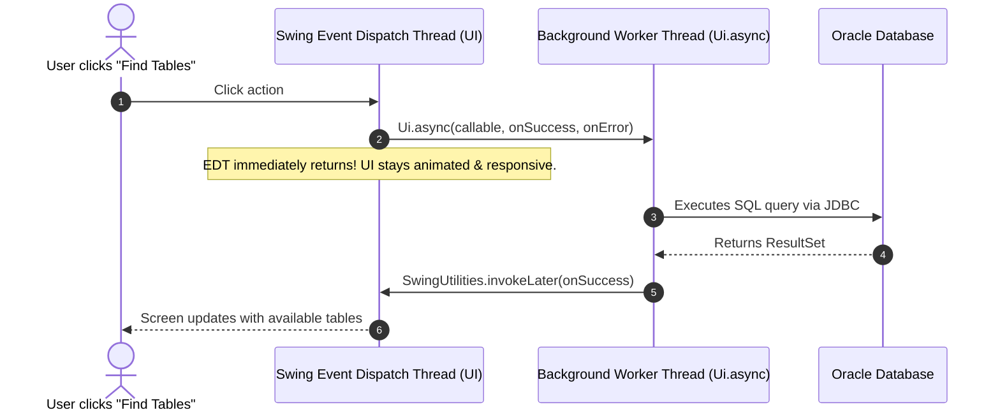

# 01 — System Architecture, Build System & Dependencies

> **Document Purpose:** An in-depth, beginner-friendly guide explaining the overall architecture, technology stack, build tools, external dependencies, threading model, and project directory structure of the **Restaurant Table Reservation System (RTRS)**.
> **Verified against codebase:** [pom.xml](file:///d:/Desktop/project/RTRS/pom.xml), [Main.java](file:///d:/Desktop/project/RTRS/src/main/java/app/Main.java), [DatabaseConnection.java](file:///d:/Desktop/project/RTRS/src/main/java/db/DatabaseConnection.java), [Ui.java](file:///d:/Desktop/project/RTRS/src/main/java/util/Ui.java), [AppLog.java](file:///d:/Desktop/project/RTRS/src/main/java/util/AppLog.java).

---

## 1. What is RTRS? (The Layman Explanation)

Imagine walking into a busy restaurant on a Saturday evening. 
- A family of 4 arrives: they need a 4-seater table, not an 8-seater (which would waste precious seats) and not a 2-seater (where they wouldn't fit).
- Two reception cashiers are taking phone calls simultaneously: both try to book **Table 5** for tomorrow at **7:30 PM**. If the software is badly designed, both customers will be told "You're booked!", and tomorrow night they will fight over the same physical table.
- A cashier cancels a booking: the system must instantly make that table available for someone else, without erasing the history of who cancelled it.

The **Restaurant Table Reservation System (RTRS)** is a standalone desktop application built to solve exactly this problem. It allows restaurant staff to:
1. Register and search customers.
2. View and manage physical dining tables across various zones (Indoor, Outdoor, Window, Hall).
3. Book tables across 5 distinct, non-overlapping 90-minute daily seating slots.
4. Automatically receive a **"best-fit table recommendation"** so small parties don't take up huge tables.
5. Guarantee with 100% mathematical certainty that **no two customers can ever double-book the same table for the same time slot**, backed by the database engine itself.

---

## 2. Why is it Built This Way? (Core Constraints & Scope)

This application was engineered for **Project 13: Object-Oriented Programming Using Java and Database Technology Laboratory**.

| Constraint | What It Means | Why We Follow It |
|---|---|---|
| **No Web Framework (No React, Vue, Next.js, HTML/CSS server)** | The app runs as a native desktop program on the computer. | Focuses on core Java Swing/AWT desktop engineering and operating system integration. |
| **No Spring Boot / No Java EE** | No dependency injection containers or bloated server frameworks. | Every class, object lifecycle, and thread is controlled directly by our own code. |
| **No ORM (No Hibernate, JPA, MyBatis)** | We write pure SQL using JDBC `PreparedStatement`. | Demonstrates complete mastery of relational database concepts, connection lifecycles, and transaction boundaries. |
| **Dedicated Database Engine (Oracle Database XE)** | We do not store data in files or SQLite; we use industrial Oracle Database. | Allows Oracle's transactional ACID engine, row-level locks, and unique indexes to enforce business rules. |

---

## 3. Technology Stack & Dependencies: What We Use and Why

All libraries and build configurations are declared in [pom.xml](file:///d:/Desktop/project/RTRS/pom.xml). Here is an exhaustive breakdown of every tool and library:

### 3.1. Java 21 (JDK 21)
- **What it is:** The programming language runtime and compiler.
- **Why we use it:** Java 21 is a Long-Term Support (LTS) version. It gives us modern language features (enhanced `switch` expressions, records, cleaner syntax) while ensuring backwards compatibility with Oracle Database XE.
- **Configured in [pom.xml](file:///d:/Desktop/project/RTRS/pom.xml):**
  ```xml
  <properties>
      <maven.compiler.source>21</maven.compiler.source>
      <maven.compiler.target>21</maven.compiler.target>
  </properties>
  ```

### 3.2. Apache Maven
- **What it is:** The project management and build automation tool.
- **Why we use it:** Instead of manually downloading `.jar` files from the internet and placing them in folders, Maven downloads the exact versions declared in [pom.xml](file:///d:/Desktop/project/RTRS/pom.xml), compiles the Java code, runs unit tests, and packages everything into an executable.

### 3.3. Oracle JDBC Driver (`ojdbc8:21.9.0.0`)
- **What it is:** The "translator" library that allows Java to talk to an Oracle Database over a network connection.
- **Why we use it:** Java does not know Oracle's internal network wire protocol by default. `ojdbc8` provides the official Oracle implementation of JDBC interfaces (`Connection`, `PreparedStatement`, `ResultSet`). Version `21.9.0.0` works seamlessly across Oracle Database 11g XE, 18c XE, and 21c XE.
- **Configured in [pom.xml](file:///d:/Desktop/project/RTRS/pom.xml):**
  ```xml
  <dependency>
      <groupId>com.oracle.database.jdbc</groupId>
      <artifactId>ojdbc8</artifactId>
      <version>21.9.0.0</version>
  </dependency>
  ```

### 3.4. FlatLaf Look and Feel (`flatlaf:3.5.1` & `flatlaf-fonts-inter:4.0`)
- **What it is:** A modern desktop UI styling engine for Java Swing, combined with the clean **Inter** font family.
- **Why we use it:** Standard Java Swing looks like it was made in 1998 (grey, square, boxy, ugly default fonts). FlatLaf transforms standard Swing components into modern, elegant desktop controls with rounded corners (`Component.arc = 12`), subtle hover effects, clean table padding, and modern typography—without having to switch to a web framework.
- **How it is initialized in [Main.java](file:///d:/Desktop/project/RTRS/src/main/java/app/Main.java#L20-L35):**
  ```java
  FlatInterFont.install();
  UIManager.put("defaultFont", new Font(FlatInterFont.FAMILY, Font.PLAIN, 14));
  FlatLightLaf.setup();
  UIManager.put("Component.arc", 12);
  UIManager.put("Button.arc", 12);
  UIManager.put("TextComponent.arc", 10);
  UIManager.put("Table.rowHeight", 38);
  ```

### 3.5. JUnit 5 (`junit-jupiter:5.10.2`)
- **What it is:** An automated testing framework.
- **Why we use it:** To prove that our business logic (like table recommendation and phone number validation) works properly under all conditions. Running `mvn test` automatically executes our test cases in milliseconds without needing to start the database or GUI.
- **Configured in [pom.xml](file:///d:/Desktop/project/RTRS/pom.xml):**
  ```xml
  <dependency>
      <groupId>org.junit.jupiter</groupId>
      <artifactId>junit-jupiter</artifactId>
      <version>5.10.2</version>
      <scope>test</scope>
  </dependency>
  ```

### 3.6. Maven Shade Plugin (`maven-shade-plugin:3.5.2`)
- **What it is:** A packaging plugin that builds a "Fat JAR" (Uber JAR).
- **Why we use it:** Ordinarily, a compiled `.jar` file only contains your own classes. To run it, you would have to manually specify the classpath containing the Oracle driver and FlatLaf jars. The Shade plugin bundles our code **plus all third-party libraries** into a single, self-contained `target/rtrs.jar` file. Anyone with Java installed can double-click or run:
  ```bash
  java -jar target/rtrs.jar
  ```

---

## 4. Multi-Tier Layered Architecture: The Restaurant Analogy

To understand how the code is organized, imagine how a high-end restaurant operates:

```
[ Customer / Receptionist ]
           │
           ▼
┌──────────────────────────────────────────────┐
│  1. Presentation Layer (ui, ui.components)   │  <-- The Waiter / Front Desk Receptionist
└──────────────────────┬───────────────────────┘
                       │ Calls pure Java methods (No SQL allowed!)
                       ▼
┌──────────────────────────────────────────────┐
│  2. Service Layer (service, util.Validation) │  <-- The Head Floor Manager
└──────────────────────┬───────────────────────┘
                       │ Manages business logic, capacity check, transactions
                       ▼
┌──────────────────────────────────────────────┐
│  3. Data Access Layer (dao)                  │  <-- The Filing Clerk / Log Book Officer
└──────────────────────┬───────────────────────┘
                       │ Writes and executes parameterized SQL statements
                       ▼
┌──────────────────────────────────────────────┐
│  4. Database Connection (db)                 │  <-- The Secure Telephone Line
└──────────────────────┬───────────────────────┘
                       │ Establishes and manages JDBC connections
                       ▼
┌──────────────────────────────────────────────┐
│  5. Database Engine (Oracle Database XE)     │  <-- The Locked Master Bank Vault
└──────────────────────────────────────────────┘
```

### Layer Rules (Strict Separation of Concerns)
1. **Presentation Layer ([`ui`](file:///d:/Desktop/project/RTRS/src/main/java/ui), [`ui.components`](file:///d:/Desktop/project/RTRS/src/main/java/ui/components)):**
   - **Rule:** Contains **ZERO SQL statements** and never imports `java.sql.*`.
   - **Responsibility:** Draws buttons, tables, cards, dialogs, and captures user input.
2. **Service Layer ([`service`](file:///d:/Desktop/project/RTRS/src/main/java/service)):**
   - **Rule:** Never manipulates Swing UI widgets directly.
   - **Responsibility:** Validates inputs, coordinates table recommendations, manages database transactions (`commit` and `rollback`), and enforces business rules.
3. **Data Access Layer ([`dao`](file:///d:/Desktop/project/RTRS/src/main/java/dao)):**
   - **Rule:** Only place where SQL queries exist.
   - **Responsibility:** Takes domain objects, converts them into parameterized SQL statements, and maps database results back to Java objects.
4. **Database Connection ([`db`](file:///d:/Desktop/project/RTRS/src/main/java/db)):**
   - **Responsibility:** Reads credentials, manages connection timeouts, and provides fresh JDBC connections.
5. **Database Engine (Oracle XE):**
   - **Responsibility:** Stores data permanently and acts as the final judge for integrity rules (like unique booking constraints and capacity limits).

---

## 5. Threading Model: Keeping the UI Silky Smooth

### The "Frozen Screen" Problem
In Java Swing, all user interface drawing and button clicks happen on a single thread called the **Event Dispatch Thread (EDT)**.
- If a user clicks "Book Table" and the Java code queries the database on the EDT, the entire screen freezes while waiting for Oracle to respond over the network.
- The window cannot be moved, buttons cannot be clicked, and the operating system may say "Program Not Responding".

### Our Solution: `Ui.async` with `SwingWorker`
To prevent freezes, the application uses a custom asynchronous utility in [Ui.java](file:///d:/Desktop/project/RTRS/src/main/java/util/Ui.java):



**How it looks in code ([Ui.java](file:///d:/Desktop/project/RTRS/src/main/java/util/Ui.java#L21-L46)):**
```java
Ui.async(
    // 1. Heavy database work runs on a background thread:
    () -> reservationService.findAvailableTables(date, slot, guests),
    
    // 2. Success callback runs back safely on the EDT:
    tables -> tableGridPanel.setTables(tables),
    
    // 3. Error callback runs on the EDT to show a toast or alert:
    error -> Toast.show(this, error.getMessage(), Toast.Type.DANGER)
);
```

---

## 6. Configuration Management: How the App Connects

Database connection settings are loaded dynamically by [DatabaseConnection.java](file:///d:/Desktop/project/RTRS/src/main/java/db/DatabaseConnection.java#L28-L62).

### Priority Order for Settings:
1. **`.env` file in the project root** (Highest priority):
   ```ini
   DB_URL=jdbc:oracle:thin:@localhost:1521/XEPDB1
   DB_USER=rtrs
   DB_PASSWORD=your_db_password
   ```
2. **`config.properties` file in the project root** (Fallback):
   ```properties
   db.url=jdbc:oracle:thin:@localhost:1521/XEPDB1
   db.user=rtrs
   db.password=your_db_password
   ```
3. **Operating System Environment Variables** (`System.getenv`).

### Built-in Robustness:
- **Quote stripping:** If the password in `.env` is surrounded by quotes (`"secret"` or `'secret'`), the parser automatically removes them.
- **Login Timeout:** `DriverManager.setLoginTimeout(5)` ensures the application will not hang indefinitely if the Oracle listener is offline.
- **Security:** `.env` and `config.properties` are listed in `.gitignore` so database passwords are never committed to version control. Committed template files are provided as `.env.example` and `config.properties.example`.

---

## 7. Logging Subsystem (`util.AppLog`)

Instead of messy `System.out.println()` statements that vanish when the console closes, the application uses a structured logging subsystem in [AppLog.java](file:///d:/Desktop/project/RTRS/src/main/java/util/AppLog.java):

- Logs are written simultaneously to:
  1. The developer terminal (Standard Output / Standard Error).
  2. A persistent log file: `logs/app.log`.
- Log entries include exact timestamps, log levels (`INFO`, `WARNING`, `SEVERE`), and full exception stack traces for easy debugging.

---

## 8. Complete Project File Directory Map

Here is the exact structure of the entire project repository:

```
d:\Desktop\project\RTRS\
├── pom.xml                          # Maven build definition and dependencies
├── .env.example                     # Sample database environment file
├── config.properties.example        # Sample configuration properties file
├── run.bat                          # One-click Windows launch script
├── run.sh                           # One-click Linux/macOS launch script
├── README.md                        # Quickstart documentation
│
├── sql/                             # Oracle SQL scripts
│   ├── 01_schema.sql                # Tables, sequences, triggers, unique index
│   ├── 02_seed.sql                  # Sample demo data (customers, tables, bookings)
│   ├── 03_drop_all.sql              # Clean database teardown script
│   └── 04_double_booking_demo.sql   # Two-session proof of engine-level conflict rejection
│
├── docs/                            # In-depth architectural & viva documentation
│   ├── 01_ARCHITECTURE_AND_DEPENDENCIES.md
│   ├── 02_DATABASE_IN_DEPTH.md
│   ├── 03_JAVA_BACKEND_AND_MODULES.md
│   ├── 04_UI_AND_PRESENTATION_LAYER.md
│   └── 05_TESTING_VERIFICATION_AND_VIVA_GUIDE.md
│
├── src/main/java/
│   ├── app/
│   │   └── Main.java                # Application entry point & FlatLaf bootstrap
│   ├── db/
│   │   └── DatabaseConnection.java  # Connection factory, .env loader & health checks
│   ├── exception/                   # Custom domain exception hierarchy
│   │   ├── AppException.java
│   │   ├── BookingConflictException.java
│   │   ├── DataAccessException.java
│   │   ├── DatabaseUnavailableException.java
│   │   ├── ReferenceInUseException.java
│   │   └── ValidationException.java
│   ├── model/                       # Domain POJOs & enums
│   │   ├── Customer.java
│   │   ├── DashboardStats.java
│   │   ├── Reservation.java
│   │   ├── ReservationDetail.java
│   │   ├── ReservationFilter.java
│   │   ├── ReservationStatus.java   # Enum: CONFIRMED, CANCELLED, COMPLETED
│   │   ├── RestaurantTable.java
│   │   ├── TableAvailability.java
│   │   ├── TableState.java          # Enum: AVAILABLE, RESERVED, MAINTENANCE
│   │   ├── TableStatus.java         # Enum: AVAILABLE, MAINTENANCE, INACTIVE
│   │   └── TimeSlot.java
│   ├── dao/                         # Data Access Objects (Pure SQL)
│   │   ├── CrudDAO.java             # Generic interface for CRUD
│   │   ├── CustomerDAO.java
│   │   ├── ReportDAO.java
│   │   ├── ReportResult.java
│   │   ├── ReservationDAO.java
│   │   ├── TableDAO.java
│   │   └── TimeSlotDAO.java
│   ├── service/                     # Business logic & transaction control
│   │   ├── CustomerService.java
│   │   ├── ReportService.java
│   │   ├── ReservationService.java  # Booking transactions, recommendation algorithm
│   │   └── TableService.java
│   ├── util/                        # Reusable utility helpers
│   │   ├── AppLog.java              # File & console logger
│   │   ├── OracleErrorMapper.java   # Translates ORA- error codes to AppExceptions
│   │   ├── Ui.java                  # Background threading helper (SwingWorker)
│   │   └── ValidationUtil.java      # Static regex & business validation
│   └── ui/                          # Presentation layer (Java Swing + FlatLaf)
│       ├── BasePanel.java           # Abstract template panel
│       ├── CustomerPanel.java       # Customer management screen
│       ├── DashboardPanel.java      # Operational metrics dashboard
│       ├── MainFrame.java           # Root window, CardLayout shell & DB error handler
│       ├── NewReservationPanel.java # 3-Step streamlined reservation flow
│       ├── ReportsPanel.java        # Tabular reports & vector bar chart
│       ├── ReservationsPanel.java   # Search, cancellation & history screen
│       ├── Sidebar.java             # Left dark navigation sidebar
│       ├── Theme.java               # Color palette, spacing tokens & fonts
│       └── components/              # Reusable custom UI widgets
│           ├── AddCustomerDialog.java
│           ├── BarChartPanel.java   # Custom Graphics2D vector bar chart
│           ├── BookingConfirmedDialog.java
│           ├── DateSelector.java    # Quick date chips + JSpinner
│           ├── SearchableComboBox.java
│           ├── StatCard.java        # Metric card
│           ├── StatusPillRenderer.java
│           ├── TableCard.java       # Custom Graphics2D dining table card
│           ├── TableGridPanel.java  # Wrapping card grid
│           ├── Toast.java           # Non-blocking notification banner
│           └── WrapLayout.java      # FlowLayout with dynamic height wrap
│
└── src/test/java/                   # Automated unit test suite (JUnit 5)
    ├── service/
    │   └── ReservationServiceTest.java # Table recommendation algorithm tests
    └── util/
        └── ValidationUtilTest.java     # Phone normalizer & validation tests
```

---

## 9. How to Build and Run the Project

### 9.1. Compile and Run Unit Tests
```bash
mvn test
```
Executes all 20 automated unit tests in [ReservationServiceTest.java](file:///d:/Desktop/project/RTRS/src/test/java/service/ReservationServiceTest.java) and [ValidationUtilTest.java](file:///d:/Desktop/project/RTRS/src/test/java/util/ValidationUtilTest.java).

### 9.2. Package into Runnable Fat JAR
```bash
mvn clean package -DskipTests
```
Produces `target/rtrs.jar`.

### 9.3. Launch the Application
- **On Windows:**
  ```cmd
  run.bat
  ```
  *(Or execute `java -jar target/rtrs.jar`)*
- **On Linux / macOS:**
  ```bash
  chmod +x run.sh
  ./run.sh
  ```
