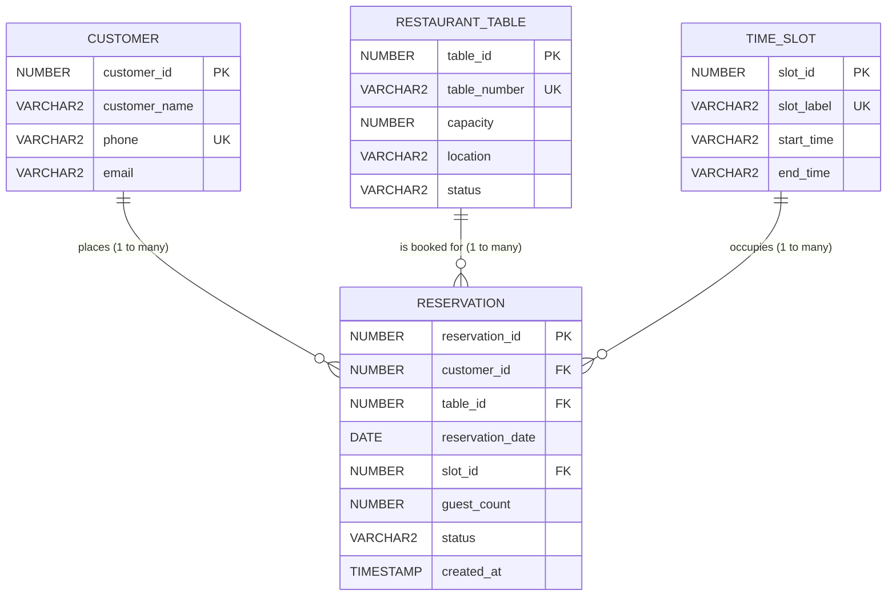

# 02 — Oracle Database In-Depth: Schema, Concurrency, Constraints & Normalization

> **Document Purpose:** An exhaustive, layman-friendly guide to the database architecture of the **Restaurant Table Reservation System (RTRS)**. Explains why we use Oracle, every table, every constraint, how transactions work, how double bookings are physically prevented at the engine level, and the complete theoretical derivation of relational normalization (1NF $\rightarrow$ BCNF).
> **Verified against codebase:** [01_schema.sql](file:///d:/Desktop/project/RTRS/sql/01_schema.sql), [02_seed.sql](file:///d:/Desktop/project/RTRS/sql/02_seed.sql), [03_drop_all.sql](file:///d:/Desktop/project/RTRS/sql/03_drop_all.sql), [04_double_booking_demo.sql](file:///d:/Desktop/project/RTRS/sql/04_double_booking_demo.sql), [DatabaseConnection.java](file:///d:/Desktop/project/RTRS/src/main/java/db/DatabaseConnection.java), [OracleErrorMapper.java](file:///d:/Desktop/project/RTRS/src/main/java/util/OracleErrorMapper.java).

---

## 1. Why Oracle Database? (The Bank Vault Analogy)

In amateur software, developers often put all their validation rules inside the Java code. 
- *The Problem:* What if someone opens SQL Developer, SQL*Plus, or an external script and inserts rows directly? Or what if two cashiers click "Book" at the exact same millisecond? The Java code can easily experience race conditions and save duplicate records.
- *The Solution:* We treat **Oracle Database as an uncompromising bank vault**. Even if someone bypasses our Java code completely, Oracle's engine will slam the door shut and refuse to allow two active bookings for the same table at the same time.

---

## 2. JDBC Connection Lifecycle & Transactions

Database connectivity is managed by [DatabaseConnection.java](file:///d:/Desktop/project/RTRS/src/main/java/db/DatabaseConnection.java).

### 2.1. Why Independent Connections?
- Instead of using a complex external connection pool library, `DatabaseConnection.getConnection()` creates an independent physical connection when requested.
- In Java, callers use the **try-with-resources** pattern:
  ```java
  try (Connection con = DatabaseConnection.getConnection()) {
      // Execute SQL operations
  } // The connection is AUTOMATICALLY closed here, even if an error occurs!
  ```
- This guarantees **zero connection leaks** and ensures each business transaction has isolated transactional boundaries.

### 2.2. Transaction Demarcation (`commit` vs `rollback`)
When booking a table, multiple database checks and operations must succeed together as one indivisible unit of work (an **Atomic Transaction**):
1. `con.setAutoCommit(false);` $\rightarrow$ Tells Oracle: *"Do not save changes automatically. Hold them in memory until I say so."*
2. We acquire a row lock and verify the table.
3. We insert the new reservation record.
4. `con.commit();` $\rightarrow$ Tells Oracle: *"Everything succeeded. Save changes permanently to disk."*
5. If anything fails (e.g., someone else took the table), `con.rollback();` immediately cancels every step, restoring the database to its pristine original state.

---

## 3. Relational Schema & Tables (`sql/01_schema.sql`)

The database is built from 4 clean, normalized tables:



---

### 3.1. `CUSTOMER` Table (Master Customer Registry)

Stores dining customers.

| Column | Type | Constraints | Layman Explanation & Purpose |
|---|---|---|---|
| `customer_id` | `NUMBER(10)` | `PRIMARY KEY` | Auto-generated serial ID from sequence `customer_seq`. |
| `customer_name` | `VARCHAR2(100)` | `NOT NULL` | Full name of the customer (e.g., "Arun Sharma"). |
| `phone` | `VARCHAR2(15)` | `NOT NULL`, `UNIQUE (uq_customer_phone)` | 10-digit mobile number. **Unique** because no two customers share a phone. |
| `email` | `VARCHAR2(100)` | `CHECK (email IS NULL OR email LIKE '%_@_%.__%')` | Optional contact email. If provided, must match email pattern. |

---

### 3.2. `RESTAURANT_TABLE` Table (Physical Dining Tables)

Represents physical furniture in the restaurant.

| Column | Type | Constraints | Layman Explanation & Purpose |
|---|---|---|---|
| `table_id` | `NUMBER(10)` | `PRIMARY KEY` | Auto-generated serial ID from sequence `table_seq`. |
| `table_number` | `VARCHAR2(10)` | `NOT NULL`, `UNIQUE (uq_table_number)` | Physical label (e.g., `T01`, `T02`). Unique across the restaurant. |
| `capacity` | `NUMBER(3)` | `NOT NULL`, `CHECK (capacity BETWEEN 1 AND 20)` | Maximum seats at this table. Kept between 1 and 20. |
| `location` | `VARCHAR2(50)` | `NOT NULL` | Zone in the restaurant (`Indoor`, `Window`, `Outdoor`, `Hall`). |
| `status` | `VARCHAR2(20)` | `DEFAULT 'AVAILABLE' NOT NULL`, `CHECK (status IN ('AVAILABLE','MAINTENANCE','INACTIVE'))` | Permanent physical operational state. |

> [!IMPORTANT]
> **A Vital Architectural Distinction: Permanent Status vs. Temporal Availability**  
> Notice that `restaurant_table.status` can only be `AVAILABLE`, `MAINTENANCE`, or `INACTIVE`. **It is NEVER changed to "RESERVED"!**  
> *Why?* A table is not reserved for all eternity—it is only reserved for a specific 90-minute slot on a specific date. A table can be reserved tomorrow at 7:30 PM, yet completely available at 9:00 PM on that same evening. Whether a table is "Available" is calculated dynamically by checking the `RESERVATION` table!

---

### 3.3. `TIME_SLOT` Table (Data-Driven 90-Minute Seatings)

Stores the standardized dining windows.

| Slot ID | Slot Label | Start Time (24h) | End Time (24h) | Duration |
|:---:|:---:|:---:|:---:|:---:|
| **1** | `12:00 PM` | `12:00` | `13:30` | 90 minutes (Lunch Seating 1) |
| **2** | `01:30 PM` | `13:30` | `15:00` | 90 minutes (Lunch Seating 2) |
| **3** | `06:00 PM` | `18:00` | `19:30` | 90 minutes (Dinner Seating 1) |
| **4** | `07:30 PM` | `19:30` | `21:00` | 90 minutes (Dinner Seating 2) |
| **5** | `09:00 PM` | `21:00` | `22:30` | 90 minutes (Late Dinner Seating 3) |

#### Why Fixed 90-Minute Seatings instead of 30-Minute Overlapping Times?
In novice designs, developers offer times like `12:00`, `12:30`, `01:00`.
- *The Flaw:* If Party A books from 12:00 to 1:30, and Party B books at 12:30, they physically collide. Preventing this requires complex, slow mathematical date-range overlapping formulas.
- *The Solution:* Real fine-dining restaurants use **fixed seatings**. By dividing operating hours into discrete, non-overlapping 90-minute blocks, seatings become clean **relational data**. Adding a new seating in the future requires a simple SQL `INSERT`, without modifying Java code.

---

### 3.4. `RESERVATION` Table (Dining Bookings)

Connects a customer, a table, and a time slot on a specific date.

| Column | Type | Constraints | Purpose |
|---|---|---|---|
| `reservation_id` | `NUMBER(10)` | `PRIMARY KEY` | Serial ID from sequence `reservation_seq` (Starts at 1001 $\rightarrow$ `RES1001`). |
| `customer_id` | `NUMBER(10)` | `FOREIGN KEY REFERENCES customer` | Who booked the table. |
| `table_id` | `NUMBER(10)` | `FOREIGN KEY REFERENCES restaurant_table` | Which physical table was booked. |
| `reservation_date` | `DATE` | `NOT NULL`, `CHECK (reservation_date = TRUNC(reservation_date))` | The calendar date of the booking. Truncated to midnight. |
| `slot_id` | `NUMBER(3)` | `FOREIGN KEY REFERENCES time_slot` | Which 90-minute seating window. |
| `guest_count` | `NUMBER(3)` | `NOT NULL`, `CHECK (guest_count > 0)` | Number of people dining. |
| `status` | `VARCHAR2(20)` | `DEFAULT 'CONFIRMED'`, `CHECK (status IN ('CONFIRMED','CANCELLED','COMPLETED'))` | Lifecycle state of this reservation. |
| `created_at` | `TIMESTAMP` | `DEFAULT SYSTIMESTAMP NOT NULL` | Audit timestamp of when the booking was made. |

> [!NOTE]
> **Why `TRUNC(reservation_date)` is Enforced:**  
> In Oracle, the `DATE` type contains both a date and a time (hours, minutes, seconds). If someone inserted `2026-10-15 14:32:00` and someone else inserted `2026-10-15 16:00:00`, Oracle would treat them as two different dates, dodging unique constraints!  
> The check constraint `reservation_date = TRUNC(reservation_date)` forces the time portion to strictly be `00:00:00` (midnight).

---

## 4. The Hero Feature: Double-Booking Prevention at Oracle Engine Level

How do we guarantee that two people never book the same table for the same date and slot?

### The "Naive" Approach That Fails
A beginner might try:
```sql
-- FLAWED APPROACH:
ALTER TABLE reservation ADD CONSTRAINT uq_res UNIQUE (table_id, reservation_date, slot_id);
```
**Why this breaks:** If a customer cancels their booking, `status` becomes `'CANCELLED'`. Under a naive unique constraint, no one else could EVER book that table for that slot again, because the cancelled record is still in the table! Deleting the row would erase the restaurant's financial and auditing history.

---

### The Genius Solution: Function-Based Unique Index (`UQ_ACTIVE_BOOKING`)

In [01_schema.sql](file:///d:/Desktop/project/RTRS/sql/01_schema.sql#L67-L71), we define:

```sql
CREATE UNIQUE INDEX uq_active_booking ON reservation (
    CASE WHEN status IN ('CONFIRMED','COMPLETED') THEN table_id         END,
    CASE WHEN status IN ('CONFIRMED','COMPLETED') THEN reservation_date END,
    CASE WHEN status IN ('CONFIRMED','COMPLETED') THEN slot_id          END
);
```

#### How it works mathematically (The "Ghost Index" Analogy):
1. **Oracle Rule for B-Tree Indexes:** In Oracle, if an index expression evaluates to `NULL` for all columns, **Oracle does NOT store that entry in the index**.
2. **When status is `CONFIRMED` or `COMPLETED`:**
   - The expression evaluates to: `(table_id, reservation_date, slot_id)`.
   - Oracle inserts these values into the unique index.
   - If another row tries to insert the exact same table, date, and slot with status `CONFIRMED`, Oracle halts execution and throws error:  
     `ORA-00001: unique constraint (RTRS.UQ_ACTIVE_BOOKING) violated`.
3. **When status is `CANCELLED`:**
   - The `CASE` expression has no `ELSE` branch, so it defaults to `NULL`.
   - The expression evaluates to: `(NULL, NULL, NULL)`.
   - Oracle completely ignores it in the unique index!
   - **Result:** The slot is immediately freed up for someone else to book, while the cancelled record remains safely saved in the table for history and manager reports!

---

## 5. Procedural Database Rules: Triggers

Some business rules involve comparing values across different tables that standard SQL `CHECK` constraints cannot express. For this, we use a database trigger in [01_schema.sql](file:///d:/Desktop/project/RTRS/sql/01_schema.sql#L74-L91):

```sql
CREATE OR REPLACE TRIGGER trg_reservation_rules
BEFORE INSERT OR UPDATE OF table_id, guest_count ON reservation
FOR EACH ROW
DECLARE
    v_capacity NUMBER;
    v_status   VARCHAR2(20);
BEGIN
    -- Query the physical table's capacity and status
    SELECT capacity, status INTO v_capacity, v_status
      FROM restaurant_table WHERE table_id = :NEW.table_id;

    -- Rule 1: Party size cannot exceed table size
    IF :NEW.guest_count > v_capacity THEN
        RAISE_APPLICATION_ERROR(-20001, 'Guest count exceeds table capacity');
    END IF;

    -- Rule 2: Cannot book tables under maintenance or inactive
    IF INSERTING AND v_status <> 'AVAILABLE' THEN
        RAISE_APPLICATION_ERROR(-20002, 'Table is not available for booking');
    END IF;
END;
/
```

- If a rogue script tries to squeeze 10 people onto a 2-seater table, Oracle rejects it with error `-20001`.
- If someone tries to book a table marked as `MAINTENANCE`, Oracle rejects it with error `-20002`.

---

## 6. Oracle Error Code Mapping Subsystem (`OracleErrorMapper`)

When Oracle throws an error, it looks like this:  
`java.sql.SQLException: ORA-00001: unique constraint (RTRS.UQ_ACTIVE_BOOKING) violated`

If a receptionist sees that raw message, it creates panic.  
In [OracleErrorMapper.java](file:///d:/Desktop/project/RTRS/src/main/java/util/OracleErrorMapper.java), we intercept every Oracle error code and translate it into a friendly custom Java exception:

```
┌─────────────────────────────────┐
│ Oracle Engine Vendor Error      │
├─────────────────────────────────┤
│ ORA-00001 (UQ_ACTIVE_BOOKING)   │ ──► BookingConflictException("The requested table is already reserved...")
│ ORA-00001 (UQ_CUSTOMER_PHONE)   │ ──► ValidationException("Phone number is already registered...")
│ ORA-00001 (UQ_TABLE_NUMBER)     │ ──► ValidationException("Table number already exists...")
│ ORA-02292 (Child record found)  │ ──► ReferenceInUseException("Cannot delete because it has reservations...")
│ ORA-20001 (Trigger capacity)    │ ──► ValidationException("Guest count exceeds the selected table capacity.")
│ ORA-20002 (Trigger not avail)   │ ──► ValidationException("The selected table is currently not available.")
│ ORA-12541 / ORA-12170 (Network) │ ──► DatabaseUnavailableException("Cannot connect to the Oracle database...")
└─────────────────────────────────┘
```

---

## 7. SQL Scripts Overview

All SQL files live in the [sql/](file:///d:/Desktop/project/RTRS/sql) folder:

### 7.1. `01_schema.sql`
- Creates all 3 sequences (`customer_seq`, `table_seq`, `reservation_seq`).
- Creates all 4 tables with primary keys, unique keys, foreign keys, and check constraints.
- Creates secondary indexes on `reservation(customer_id)` and `reservation(reservation_date)`.
- Creates `UQ_ACTIVE_BOOKING` unique function-based index.
- Creates `trg_reservation_rules` trigger.
- Inserts the default 5 time slots.

### 7.2. `02_seed.sql`
- Populates realistic demo data.
- **Relative Dates:** All reservation dates use `TRUNC(SYSDATE) - 1`, `TRUNC(SYSDATE)`, `TRUNC(SYSDATE) + 1`, etc. This ensures that no matter what date or year the demonstration is run, the demo bookings are always relative to "Today", "Yesterday", and "Tomorrow".
- Seeds 6 Indian customers with valid 10-digit mobile numbers.
- Seeds 8 tables across 4 zones (`Indoor`, `Window`, `Outdoor`, `Hall`).
- Seeds 8 reservations in various states (`CONFIRMED`, `COMPLETED`, `CANCELLED`).
- **Vital Testing Anchor:** Table `T05` for tomorrow at `07:30 PM` (slot 4) is intentionally left unreserved for immediate live testing!

### 7.3. `03_drop_all.sql`
- A clean teardown script that drops all triggers, indexes, tables, and sequences with `CASCADE CONSTRAINTS`.

### 7.4. `04_double_booking_demo.sql` (The Live Examiner Proof)
A 4-step script executed across two independent SQL*Plus sessions to prove that Oracle rejects double bookings without Java:
1. **Session A:** Books Table `T05` for tomorrow at `07:30 PM`. Succeeded.
2. **Session B:** Tries to book the exact same `T05`, tomorrow, `07:30 PM`.  
   **Result:** `ORA-00001: unique constraint (RTRS.UQ_ACTIVE_BOOKING) violated`!
3. **Session A:** Cancels their reservation (`UPDATE reservation SET status = 'CANCELLED'`).
4. **Session B:** Retries the exact same insert.  
   **Result:** Succeeded! Both the cancelled row and the confirmed row coexist in the table.

---

## 8. Database Normalization Derivation (1NF to BCNF)

Normalization is the mathematical process of organizing database tables to eliminate redundant duplicate data and prevent **anomalies**.

### 8.1. The Unnormalized Flat Spreadsheet (UNF)
Imagine storing everything in one giant Excel sheet or flat table:
```text
RESERVATION_FLAT(
    reservation_id, customer_name, phone, email,
    table_number, capacity, location, table_status,
    reservation_date, slot_label, slot_start_time, slot_end_time,
    guest_count, reservation_status, created_at
)
```

### 8.2. Operational Anomalies of the Flat Design
1. **Insertion Anomaly:** You cannot add a newly purchased dining table (e.g., Table T12) into the database until a customer actually books it, because `reservation_id` would be NULL!
2. **Deletion Anomaly:** If a customer cancels their only reservation and you delete the row, you accidentally delete the customer's phone number and profile forever!
3. **Update Anomaly:** If customer "Arun Sharma" changes his phone number, you have to search through 50 historical rows. If you miss one, his contact info is corrupted and conflicting.

---

### 8.3. Step-by-Step Normalization Steps

#### Step 1: First Normal Form (1NF)
- **Rule:** Every column must contain atomic (indivisible) single scalar values. No repeating lists or comma-separated values.
- **Application:** Customer phone, dates, guest counts are stored as individual scalars. A primary key `reservation_id` is identified. The table satisfies **1NF**.

#### Step 2: Second Normal Form (2NF)
- **Rule:** Must be in 1NF and have **no partial dependencies** (no non-key attribute can depend on only part of a composite primary key).
- **Analysis:** In the flat table, customer attributes (`customer_name`, `email`) depend only on `phone`. Table attributes (`capacity`, `location`) depend only on `table_number`. Slot times depend only on `slot_label`.
- **Decomposition:** We split the flat table into 4 separate relations:
  - `CUSTOMER(customer_id, customer_name, phone, email)`
  - `RESTAURANT_TABLE(table_id, table_number, capacity, location, status)`
  - `TIME_SLOT(slot_id, slot_label, start_time, end_time)`
  - `RESERVATION(reservation_id, customer_id, table_id, slot_id, reservation_date, guest_count, status, created_at)`
- The schema satisfies **2NF**.

#### Step 3: Third Normal Form (3NF)
- **Rule:** Must be in 2NF and have **no transitive dependencies** ($A \rightarrow B$ and $B \rightarrow C$ where $C$ depends on $A$ through $B$).
- **Application:** In our decomposed tables, all attributes in `CUSTOMER` depend directly on `customer_id`. All attributes in `RESTAURANT_TABLE` depend directly on `table_id`. In `RESERVATION`, foreign keys (`customer_id`, `table_id`, `slot_id`) link to external entities without storing their internal properties (like customer name or table capacity).
- The schema satisfies **3NF**.

#### Step 4: Boyce-Codd Normal Form (BCNF)
- **Rule:** For every functional dependency $X \rightarrow Y$, the determinant $X$ must be a **superkey** (candidate key).
- In `CUSTOMER`: Determinants are `{customer_id}` and `{phone}` (both unique keys).
- In `RESTAURANT_TABLE`: Determinants are `{table_id}` and `{table_number}` (both unique keys).
- In `TIME_SLOT`: Determinants are `{slot_id}` and `{slot_label}` (both unique keys).
- In `RESERVATION`: Determinants are `{reservation_id}` and the active compound key `{table_id, reservation_date, slot_id}` (enforced by the unique index).
- Since every determinant is a candidate key, the schema achieves **BCNF**!
