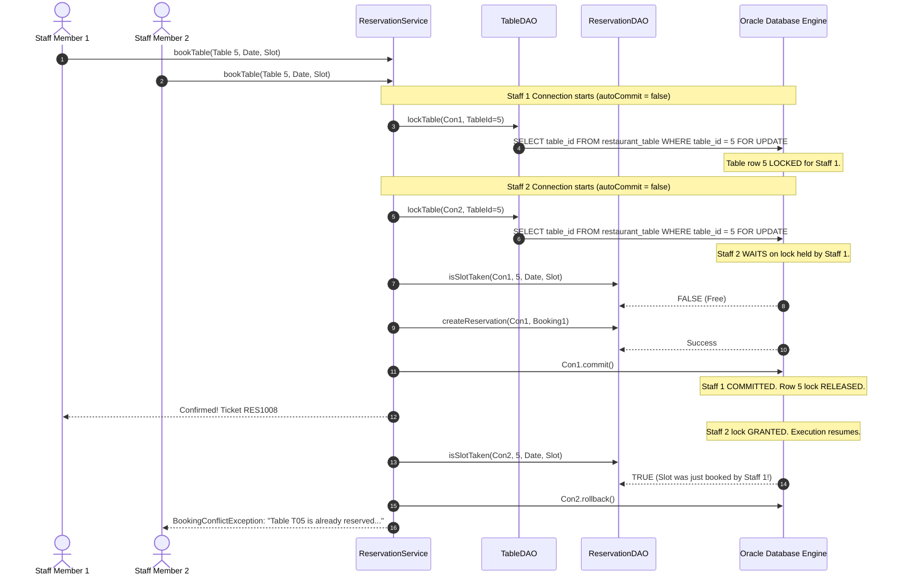

# 03 — Java Backend Modules: Architecture, OOP Principles, DAOs, Services & Logic

> **Document Purpose:** An in-depth, layman-friendly guide to the Java backend architecture of the **Restaurant Table Reservation System (RTRS)**. Explains the Object-Oriented Programming (OOP) design patterns, all domain models, Data Access Objects (DAOs), service transaction boundaries, pessimistic row locking (`FOR UPDATE`), the greedy table recommendation algorithm, and input validation.
> **Verified against codebase:** [model/](file:///d:/Desktop/project/RTRS/src/main/java/model), [dao/](file:///d:/Desktop/project/RTRS/src/main/java/dao), [service/](file:///d:/Desktop/project/RTRS/src/main/java/service), [exception/](file:///d:/Desktop/project/RTRS/src/main/java/exception), [ValidationUtil.java](file:///d:/Desktop/project/RTRS/src/main/java/util/ValidationUtil.java).

---

## 1. Object-Oriented Programming (OOP) Principles Showcase

In academic evaluations and technical interviews, examiners specifically look for deliberate, elegant demonstrations of the four core pillars of Object-Oriented Programming:

```
┌────────────────────────────────────────────────────────────────────────┐
│                   THE 4 PILLARS OF OOP IN RTRS                         │
├────────────────────┬────────────────────┬──────────────────────────────┤
│ 1. Encapsulation   │ 2. Polymorphism    │ 3. Inheritance & Composition │
├────────────────────┼────────────────────┼──────────────────────────────┤
│ Private fields     │ Generic CrudDAO    │ Custom AppException tree     │
│ Getters & Setters  │ Interface with     │ BasePanel template pattern   │
│ Immutable records  │ CustomerDAO &      │ ReservationService composes  │
│ Overridden methods │ TableDAO           │ 4 independent DAOs           │
└────────────────────┴────────────────────┴──────────────────────────────┘
```

### 1.1. Encapsulation
- **What it means:** Keeping an object's internal variables hidden from external code, so no one can set illegal or corrupt values.
- **In our code:** Every domain class (such as [Customer.java](file:///d:/Desktop/project/RTRS/src/main/java/model/Customer.java) and [RestaurantTable.java](file:///d:/Desktop/project/RTRS/src/main/java/model/RestaurantTable.java)) declares its member variables as `private`. Access is strictly controlled through public getters and setters. Classes override standard `equals()`, `hashCode()`, and `toString()`.

### 1.2. Polymorphism & Generics
- **What it means:** Writing a single, reusable contract that works across different types of entities.
- **In our code:** The interface [CrudDAO<T, ID>](file:///d:/Desktop/project/RTRS/src/main/java/dao/CrudDAO.java) defines standard database actions:
  ```java
  public interface CrudDAO<T, ID> {
      void add(T entity);
      Optional<T> getById(ID id);
      List<T> getAll();
      void update(T entity);
      void delete(ID id);
  }
  ```
  Both [CustomerDAO.java](file:///d:/Desktop/project/RTRS/src/main/java/dao/CustomerDAO.java) (`implements CrudDAO<Customer, Integer>`) and [TableDAO.java](file:///d:/Desktop/project/RTRS/src/main/java/dao/TableDAO.java) (`implements CrudDAO<RestaurantTable, Integer>`) implement this common interface polymorphically.

### 1.3. Inheritance
- **What it means:** Subclasses inheriting capabilities from a common parent class.
- **In our code:**
  - **Exception Hierarchy:** [AppException.java](file:///d:/Desktop/project/RTRS/src/main/java/exception/AppException.java) extends `RuntimeException`. All domain errors (`ValidationException`, `BookingConflictException`, `ReferenceInUseException`, `DatabaseUnavailableException`) inherit from `AppException`.
  - **UI Template:** [BasePanel.java](file:///d:/Desktop/project/RTRS/src/main/java/ui/BasePanel.java) extends `JPanel` to enforce consistent header titles, border padding, and lifecycle refresh hooks across all 6 screens.

### 1.4. Composition
- **What it means:** Building complex classes by having references to smaller, specialized components ("has-a" relationship rather than "is-a").
- **In our code:** [ReservationService.java](file:///d:/Desktop/project/RTRS/src/main/java/service/ReservationService.java#L37-L40) does not do raw database queries itself; instead, it is composed of four dedicated DAOs:
  ```java
  public class ReservationService {
      private final ReservationDAO reservationDAO;
      private final TableDAO tableDAO;
      private final CustomerDAO customerDAO;
      private final TimeSlotDAO timeSlotDAO;
      // ...
  }
  ```

---

## 2. Domain Model Layer (`model` Package)

The `model` package contains pure Java objects (POJOs) and Enums that mirror our business entities:

### 2.1. POJOs and DTOs

| Class Name | Type | Key Fields | Purpose |
|---|---|---|---|
| [Customer.java](file:///d:/Desktop/project/RTRS/src/main/java/model/Customer.java) | Entity | `customerId`, `name`, `phone`, `email` | Represents a dining patron. |
| [RestaurantTable.java](file:///d:/Desktop/project/RTRS/src/main/java/model/RestaurantTable.java) | Entity | `tableId`, `tableNumber`, `capacity`, `location`, `status` | Represents physical restaurant furniture. |
| [TimeSlot.java](file:///d:/Desktop/project/RTRS/src/main/java/model/TimeSlot.java) | Entity | `slotId`, `label`, `startTime`, `endTime` | Represents one of the 5 fixed 90-minute daily dining windows. Times are stored as `java.time.LocalTime`. |
| [Reservation.java](file:///d:/Desktop/project/RTRS/src/main/java/model/Reservation.java) | Entity | `reservationId`, `customerId`, `tableId`, `reservationDate`, `slotId`, `guestCount`, `status`, `createdAt` | Represents an individual booking. Generates human-friendly ticket numbers via `getDisplayCode()` (e.g. `RES1005`). |
| [ReservationDetail.java](file:///d:/Desktop/project/RTRS/src/main/java/model/ReservationDetail.java) | DTO (Data Transfer Object) | `reservationId`, `displayCode`, `customerName`, `phone`, `tableNumber`, `reservationDate`, `slotLabel`, `guestCount`, `status`, `createdAt` | A flattened, joined projection combining data from `reservation`, `customer`, `restaurant_table`, and `time_slot` for easy display in UI tables. |
| [TableAvailability.java](file:///d:/Desktop/project/RTRS/src/main/java/model/TableAvailability.java) | Wrapper Model | `RestaurantTable table`, `TableState state`, `boolean isRecommended` | Pairs a table with its temporary availability status and recommendation flag during the booking flow. |
| [DashboardStats.java](file:///d:/Desktop/project/RTRS/src/main/java/model/DashboardStats.java) | Aggregation DTO | `todayCount`, `freeTablesCount`, `nextSlotLabel`, `upcomingCount`, `cancelledCount`, `upcomingReservations` | Encapsulates all real-time metrics needed by the Dashboard. |
| [ReservationFilter.java](file:///d:/Desktop/project/RTRS/src/main/java/model/ReservationFilter.java) | Query DTO | `query` (text), `date` (optional), `status` (string), `tableNumber` (string) | Carries multi-criteria search filters from the UI down to the DAO. |

### 2.2. Domain Enums

1. **`ReservationStatus`:**
   - Values: `CONFIRMED`, `CANCELLED`, `COMPLETED`.
   - Purpose: Tracks the lifecycle of a reservation.
2. **`TableStatus`:**
   - Values: `AVAILABLE`, `MAINTENANCE`, `INACTIVE`.
   - Purpose: Tracks the **permanent, physical operational condition** of the furniture.
3. **`TableState`:**
   - Values: `AVAILABLE`, `RESERVED`, `MAINTENANCE`.
   - Purpose: Tracks the **temporary, real-time condition** of a table for a specific date and time slot (powers the Floor View color coding).

---

## 3. Data Access Layer (`dao` Package)

The DAO layer is the **only place in the entire codebase where SQL queries exist**.

### 3.1. Why 100% Parameterized `PreparedStatement`?
In naive applications, developers write:
```java
// VULNERABLE TO SQL INJECTION:
String sql = "SELECT * FROM customer WHERE phone = '" + userInput + "'";
```
If a malicious user enters `' OR '1'='1`, the database dumps every record.  
In RTRS, **100% of SQL statements use `?` placeholders with `PreparedStatement`**:
```java
// 100% IMMUNE TO SQL INJECTION:
String sql = "SELECT * FROM customer WHERE phone = ?";
try (PreparedStatement ps = con.prepareStatement(sql)) {
    ps.setString(1, userInput);
    // The Oracle driver treats userInput strictly as harmless string data!
}
```

---

### 3.2. Detailed Breakdown of Each DAO

#### 1. [CustomerDAO.java](file:///d:/Desktop/project/RTRS/src/main/java/dao/CustomerDAO.java)
- `addCustomer(Customer c)`: Inserts a new customer using sequence `customer_seq.NEXTVAL` and retrieves the generated ID via `ps.getGeneratedKeys()`.
- `getCustomerById(int id)`: Fetches a single customer by primary key.
- `getAllCustomers()`: Returns all registered customers sorted alphabetically by name.
- `searchCustomers(String query)`: Debounced search matching customer name (case-insensitive via `UPPER`) or phone number using `%` wildcards.
- `updateCustomer(Customer c)`: Updates name, phone, and email for an existing customer ID.
- `deleteCustomer(int id)`: Deletes customer row; if reservations reference this customer, Oracle raises `ORA-02292`, caught and mapped to `ReferenceInUseException`.
- `existsByPhone(String phone, int excludeId)`: Fast existence check to prevent duplicate phone numbers before insert/update.

#### 2. [TableDAO.java](file:///d:/Desktop/project/RTRS/src/main/java/dao/TableDAO.java)
- `addTable(RestaurantTable t)`: Inserts table using `table_seq.NEXTVAL`.
- `getTableById(int id)`: Fetches single table. Overloaded to accept an existing transactional `Connection`.
- `getAllTables()`: Returns all tables sorted by `table_number ASC`.
- `updateTable(RestaurantTable t)`: Updates table properties.
- `deleteTable(int id)`: Deletes table; if reservations exist, raises `ReferenceInUseException`.
- `lockTable(Connection con, int tableId)`: **Acquires an exclusive row lock** (`SELECT table_id FROM restaurant_table WHERE table_id = ? FOR UPDATE`) to serialize concurrent bookings.
- `getAvailableTables(LocalDate date, int slotId, int guests)`:
  Executes an optimized `NOT EXISTS` subquery returning tables that have `status = 'AVAILABLE'`, `capacity >= guests`, and **no active reservation** (`CONFIRMED` or `COMPLETED`) for that date and slot:
  ```sql
  SELECT t.table_id, t.table_number, t.capacity, t.location, t.status
  FROM   restaurant_table t
  WHERE  t.status = 'AVAILABLE'
  AND    t.capacity >= ?
  AND    NOT EXISTS (
      SELECT 1 FROM reservation r
      WHERE  r.table_id = t.table_id
      AND    r.reservation_date = ?
      AND    r.slot_id = ?
      AND    r.status IN ('CONFIRMED','COMPLETED')
  )
  ORDER BY t.capacity ASC, t.table_number ASC
  ```
- `getTableStates(LocalDate date, int slotId)`: Performs a `LEFT JOIN` between `restaurant_table` and active reservations to compute the floor map state (`AVAILABLE`, `RESERVED`, or `MAINTENANCE`) for every table.

#### 3. [ReservationDAO.java](file:///d:/Desktop/project/RTRS/src/main/java/dao/ReservationDAO.java)
- `createReservation(Connection con, Reservation r)`: Inserts booking record inside an active transaction.
- `isSlotTaken(Connection con, int tableId, LocalDate date, int slotId)`: Pre-check query verifying if an active booking already exists.
- `cancelReservation(int reservationId)`: Updates status to `'CANCELLED'`. Because of the `WHERE status = 'CONFIRMED'` clause, it only cancels active bookings.
- `markCompleted(int reservationId)`: Updates status to `'COMPLETED'`.
- `searchReservations(ReservationFilter filter)`: Dynamically constructs a parameterized SQL query based on user filters (customer text, specific date, status, table number).
- `getTodayCount()`, `getUpcomingCount()`, `getCancelledCount()`: Fast aggregation queries for dashboard counters.
- `getUpcomingReservations(int limit)`: Retrieves the top upcoming reservations for the live dashboard feed.

#### 4. [TimeSlotDAO.java](file:///d:/Desktop/project/RTRS/src/main/java/dao/TimeSlotDAO.java)
- `getAllSlots()`: Loads the 5 fixed seatings from `time_slot`, parsing 24-hr strings like `"19:30"` into Java `LocalTime` objects.

#### 5. [ReportDAO.java](file:///d:/Desktop/project/RTRS/src/main/java/dao/ReportDAO.java) & [ReportResult.java](file:///d:/Desktop/project/RTRS/src/main/java/dao/ReportResult.java)
- Houses 5 business intelligence queries returning title, column headers, and row data wrapped in a clean `ReportResult` object.

---

## 4. Business & Service Layer (`service` Package)

The service layer contains the operational intelligence and transaction control.

### 4.1. The Greedy Table Recommendation Algorithm

When a party of 3 arrives, which table should the system recommend?
- If we put them on Table T05 (Capacity 8), they are comfortable, but we just wasted 5 seats that could have accommodated a large family later!
- If we put them on Table T01 (Capacity 2), they cannot sit.
- The best choice is Table T02 or T03 (Capacity 4).

In [ReservationService.java](file:///d:/Desktop/project/RTRS/src/main/java/service/ReservationService.java#L113-L124), we implement a pure recommendation algorithm:

```java
public TableAvailability recommendTable(List<RestaurantTable> candidates, int guests) {
    if (candidates == null || candidates.isEmpty()) {
        return null;
    }

    Optional<RestaurantTable> bestMatch = candidates.stream()
            // 1. Must have enough capacity and be physically AVAILABLE
            .filter(t -> t.getCapacity() >= guests && t.getStatus() == TableStatus.AVAILABLE)
            // 2. Pick smallest capacity first (greedy best-fit)
            // 3. Break ties by lowest table number (e.g. T02 over T03)
            .min(Comparator.comparingInt(RestaurantTable::getCapacity)
                    .thenComparing(RestaurantTable::getTableNumber));

    return bestMatch.map(t -> new TableAvailability(t, TableState.AVAILABLE, true)).orElse(null);
}
```

---

### 4.2. Concurrency-Safe Booking Transaction (`bookTable`)

What happens when two staff members attempt to book the exact same table at the exact same moment?

In [ReservationService.java](file:///d:/Desktop/project/RTRS/src/main/java/service/ReservationService.java#L130-L185), we execute a multi-phase transaction:



#### Step-by-Step Transaction Walkthrough in Code:
1. **Disable Auto-Commit:** `con.setAutoCommit(false);`
2. **Pessimistic Row Lock:** `tableDAO.lockTable(con, tableId);`  
   Executes `SELECT ... FOR UPDATE`. If another transaction is currently trying to book this table, it must queue behind us.
3. **Re-verify Table State:** Checks if the table was marked as `MAINTENANCE` in the interim.
4. **Friendly Application Pre-check:** Checks `isSlotTaken()`. If taken, throws a clear `BookingConflictException`.
5. **Database Engine Insert:** Inserts the reservation. Oracle's function-based unique index `UQ_ACTIVE_BOOKING` acts as the ultimate guarantor.
6. **Commit:** `con.commit();` writes the booking permanently and releases the lock.
7. **Rollback Safety:** If any `SQLException` or `RuntimeException` happens, `con.rollback();` immediately undoes any changes.

---

### 4.3. Reservation Cancellation & Slot Release
```java
public void cancelReservation(int reservationId) {
    boolean success = reservationDAO.cancelReservation(reservationId);
    if (!success) {
        throw new ValidationException("Reservation could not be cancelled. It may already be cancelled or completed.");
    }
}
```
- Because status changes from `CONFIRMED` to `CANCELLED`, Oracle's `UQ_ACTIVE_BOOKING` expression evaluates to `NULL`.
- The slot becomes **immediately available for rebooking**, while the cancelled row is retained for reports.

---

### 4.4. Mark Completed Business Rule
```java
boolean eligible = res.getReservationDate().isBefore(today) ||
    (res.getReservationDate().isEqual(today) && slot != null && !slot.getStartTime().isAfter(now));
```
- A booking can **only** be marked `COMPLETED` if:
  1. The reservation was on a previous day, OR
  2. The reservation is today, and the seating start time has already begun.
- This prevents staff from prematurely completing future bookings.

---

## 5. Input Validation Subsystem (`util.ValidationUtil`)

To provide instant feedback before calling the database, [ValidationUtil.java](file:///d:/Desktop/project/RTRS/src/main/java/util/ValidationUtil.java) provides static validation rules:

### 5.1. Regular Expressions
- **Name Pattern:** `^[A-Za-z\s.'\-]{2,100}$` (2 to 100 letters, spaces, dots, hyphens).
- **Indian Mobile Pattern:** `^[6-9]\d{9}$` (Strictly 10 digits starting with 6, 7, 8, or 9).
- **Email Pattern:** Standard RFC format with `@` and valid domain.
- **Table Number Pattern:** `^[A-Za-z0-9\-]{1,10}$` (1 to 10 alphanumeric characters).

### 5.2. Indian Phone Number Normalization
Customers often enter numbers with spaces, hyphens, or prefixes:
- `+91 98765-43210` $\rightarrow$ normalized to `9876543210`
- `09876543210` $\rightarrow$ normalized to `9876543210`
- `919876543210` $\rightarrow$ normalized to `9876543210`

### 5.3. Error Aggregation
Instead of failing on the first error and annoying the user with multiple popups, `ValidationUtil` checks **all fields simultaneously** and aggregates them into a `Map<String, String> fieldErrors`:
```java
Map<String, String> errors = new LinkedHashMap<>();
if (name.isEmpty()) errors.put("name", "Customer name is required.");
if (phone.isEmpty()) errors.put("phone", "Phone number is required.");
if (!errors.isEmpty()) throw new ValidationException(errors);
```
The UI can then display red error labels directly beneath each invalid input field simultaneously!

---

## 6. Custom Exception Hierarchy (`exception` Package)

All custom exceptions inherit from unchecked [AppException.java](file:///d:/Desktop/project/RTRS/src/main/java/exception/AppException.java):

```
RuntimeException
      └── AppException
            ├── ValidationException (Field-level validation failures)
            ├── BookingConflictException (Table already reserved for that slot)
            ├── DatabaseUnavailableException (Oracle listener down or timeout)
            ├── ReferenceInUseException (Cannot delete table/customer with active bookings)
            └── DataAccessException (Unexpected database errors)
```

**Why Unchecked Exceptions?**
In old Java code, every method declared `throws SQLException`, cluttering UI code. By translating checked `SQLException` into clean, unchecked `AppException` subclasses, our UI components can catch errors at high-level boundaries and show clean toasts or error dialogs without boilerplate `try/catch` clutter.
