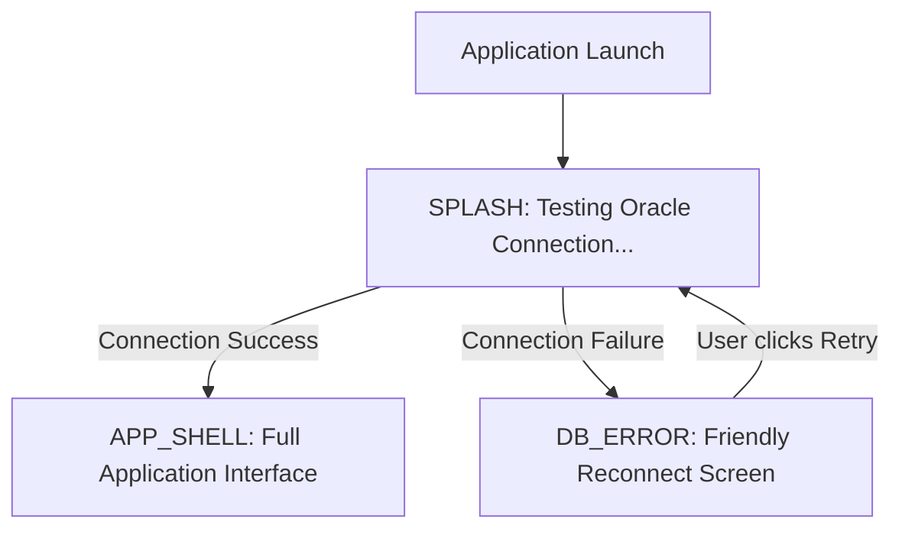

# 04 — Java Swing Presentation Layer: Design System, MainFrame & Screens

> **Document Purpose:** An in-depth, layman-friendly guide to the presentation layer of the **Restaurant Table Reservation System (RTRS)**. Explains how Java Swing is styled with FlatLaf, the design token system, the startup connection health check, all 6 application screens, the interactive 3-step booking flow, the Floor View, and all custom `Graphics2D` painted components.
> **Verified against codebase:** [ui/Theme.java](file:///d:/Desktop/project/RTRS/src/main/java/ui/Theme.java), [ui/MainFrame.java](file:///d:/Desktop/project/RTRS/src/main/java/ui/MainFrame.java), [ui/Sidebar.java](file:///d:/Desktop/project/RTRS/src/main/java/ui/Sidebar.java), [ui/BasePanel.java](file:///d:/Desktop/project/RTRS/src/main/java/ui/BasePanel.java), [ui/](file:///d:/Desktop/project/RTRS/src/main/java/ui), [ui/components/](file:///d:/Desktop/project/RTRS/src/main/java/ui/components).

---

## 1. Why Does This Swing App Look So Modern?

Default Java Swing applications often look like legacy software from 1998:
- Sharp, boxy 3D grey borders.
- Jagged default system fonts.
- Jarring `JOptionPane` popup dialogs for every tiny click.
- Screen freezing during any database query.

In RTRS, we deliberately crafted a **state-of-the-art desktop user experience**:
1. **FlatLaf Styling Engine + Inter Typography:** Clean flat surfaces, subtle borders, rounded button corners (`arc = 12`), and clean font rendering.
2. **Warm Restaurant Palette:** Inspired by luxury dining (deep slate sidebar, warm ivory backgrounds, brushed gold accent highlights).
3. **Non-Blocking Feedback:** Gentle floating **Toasts** that slide in and disappear automatically after 2.5 seconds, reserving modal dialogs only for important receipts and destructive confirmations.
4. **Visual Spatial Layouts:** Dining tables are not just rows of text in a spreadsheet—they are rendered as **custom-painted interactive cards** that show seating capacity, location, and real-time availability.

---

## 2. Design System Tokens: [Theme.java](file:///d:/Desktop/project/RTRS/src/main/java/ui/Theme.java)

To prevent random, mismatched colors scattered across different files, all visual rules are centralized in [Theme.java](file:///d:/Desktop/project/RTRS/src/main/java/ui/Theme.java):

### 2.1. Color Palette

```
┌────────────────────────────────────────────────────────┐
│               CURATED COLOR PALETTE                    │
├────────────────────┬───────────┬───────────────────────┤
│ Token Name         │ Hex Code  │ Usage in UI           │
├────────────────────┼───────────┼───────────────────────┤
│ SIDEBAR_BG         │ #17181C   │ Deep dark sidebar     │
│ APP_BG             │ #F6F4F0   │ Warm ivory canvas     │
│ CARD_BG            │ #FFFFFF   │ Clean white surfaces  │
│ CARD_BORDER        │ #E7E3DC   │ Subtle hairline edge  │
│ ACCENT_GOLD        │ #C8963E   │ Primary actions & tag │
│ ACCENT_GOLD_HOVER  │ #B58534   │ Button hover state    │
│ TEXT_PRIMARY       │ #1E2024   │ Charcoal readability  │
│ TEXT_MUTED         │ #6B7078   │ Secondary subtitles   │
│ SUCCESS            │ #2E7D5B   │ Confirmed / Available │
│ DANGER             │ #C0392B   │ Cancelled / Delete    │
│ WARNING            │ #B7791F   │ Caution alerts        │
│ MAINTENANCE_GREY   │ #9AA0A6   │ Hatched lines / Inact │
└────────────────────┴───────────┴───────────────────────┘
```

### 2.2. Standardized Spacing & Typography
- **Spacing Grid:** Multiples of 4 and 8 (`SPACE_8 = 8`, `SPACE_12 = 12`, `SPACE_16 = 16`, `SPACE_24 = 24`, `SPACE_32 = 32`).
- **Typography:**
  - `FONT_TITLE`: 26pt Bold Inter (Screen titles).
  - `FONT_SECTION`: 16pt Bold Inter (Section card headers).
  - `FONT_BODY`: 14pt Plain Inter (Standard text & tables).
  - `FONT_BODY_BOLD`: 14pt Bold Inter (Buttons & labels).
  - `FONT_SMALL`: 12pt Plain Inter (Helper text & captions).
  - `FONT_STAT_NUM`: 32pt Bold Inter (Large dashboard metrics).

---

## 3. Application Shell: [MainFrame.java](file:///d:/Desktop/project/RTRS/src/main/java/ui/MainFrame.java)

[MainFrame.java](file:///d:/Desktop/project/RTRS/src/main/java/ui/MainFrame.java) is the top-level application window (1280x800 resolution, minimum 1200x760).

### 3.1. The Root Three-State Layout
Instead of immediately crashing if the database is offline, `MainFrame` uses a root `CardLayout` with 3 screens:



1. **`SPLASH`:** Shows a clean, minimalist card: *"Connecting to database..."* while [DatabaseConnection.testConnection()](file:///d:/Desktop/project/RTRS/src/main/java/db/DatabaseConnection.java#L108) runs in the background.
2. **`DB_ERROR`:** If Oracle is offline or credentials fail:
   - Displays a warm diagnostic card with an amber warning icon.
   - Explains the exact failure reason in plain English.
   - Displays a helpful hint: *"Check config.properties and ensure Oracle XE is running on your machine."*
   - Provides an active **"Retry Connection"** button that re-tests without restarting the app!
3. **`APP_SHELL`:** The main operational interface, containing the left navigation sidebar and the content area.

---

### 3.2. Left Navigation Sidebar: [Sidebar.java](file:///d:/Desktop/project/RTRS/src/main/java/ui/Sidebar.java)
- Fixed 240px dark panel docked on the left (`BorderLayout.WEST`).
- Displays the brand header: **Reserve** with a gold diamond accent.
- Hosts 6 navigation buttons:
  1. **Dashboard**
  2. **New Reservation**
  3. **Reservations**
  4. **Customers**
  5. **Tables**
  6. **Reports**
- Active buttons feature a sleek vertical gold pill indicator on their left edge and illuminated white text.

---

## 4. Deep-Dive into All 6 Functional Screens

Every screen extends [BasePanel.java](file:///d:/Desktop/project/RTRS/src/main/java/ui/BasePanel.java), which provides an elegant top header with breadcrumb titles and an `onShown()` callback that automatically reloads fresh database records whenever the user navigates to that screen.

---

### Screen 1: Dashboard ([DashboardPanel.java](file:///d:/Desktop/project/RTRS/src/main/java/ui/DashboardPanel.java))

The command center for the restaurant manager.

```
┌────────────────────────────────────────────────────────────────────────┐
│  RESTAURANT OVERVIEW                            [+ New Reservation]   │
├───────────────────┬───────────────────┬──────────────────┬─────────────┤
│ Today's Bookings  │ Available Tables  │ Upcoming Seats   │ Cancelled   │
│       14          │   6 Free at 7:30  │       28         │      2      │
├───────────────────┴───────────────────┴──────────────────┴─────────────┤
│  LIVE UPCOMING RESERVATIONS FEED                          [ Refresh ]  │
│  ┌──────────┬─────────────┬─────────────┬───────┬────────┬──────────┐  │
│  │ ID       │ Customer    │ Phone       │ Table │ Slot   │ Status   │  │
│  │ RES1003  │ Priya Patel │ 9812345678  │ T03   │ 7:30PM │CONFIRMED │  │
│  └──────────┴─────────────┴─────────────┴───────┴────────┴──────────┘  │
└────────────────────────────────────────────────────────────────────────┘
```

1. **4 Metric StatCards:**
   - **Today's Reservations:** Count of active and completed bookings today.
   - **Available Tables:** Real-time count of free tables for the *immediate current or next upcoming seating slot*.
   - **Upcoming Bookings:** Total future confirmed seatings.
   - **Cancelled:** Count of cancellations (today and future).
2. **Quick CTA:** Direct "+ New Reservation" button that takes the cashier straight to the booking flow.
3. **Upcoming Feed:** Live table showing the next 8 reservations, with color-coded status badges and center-aligned columns.

---

### Screen 2: New Reservation ([NewReservationPanel.java](file:///d:/Desktop/project/RTRS/src/main/java/ui/NewReservationPanel.java))

The heart of the system: a guided, 3-step booking flow designed to prevent mistakes.

```
┌────────────────────────────────────────────────────────────────────────┐
│ STEP 1: WHO                                                            │
│ Select Customer: [ Priya Patel (9812345678)      ▼ ]  [+ Add Customer] │
├────────────────────────────────────────────────────────────────────────┤
│ STEP 2: WHEN & PARTY SIZE                                              │
│ Date:   (Today) [Tomorrow] (+2 Days)   [ 16-10-2026 📅 ]               │
│ Slot:   [12:00 PM]  [01:30 PM]  [06:00 PM]  (07:30 PM)  [09:00 PM]     │
│ Guests: [ 4 ↕ ]     Zone: (Any) [Indoor] [Window] [Outdoor] [Hall]     │
│                                                   [ Find Tables 🔍 ]   │
├────────────────────────────────────────────────────────────────────────┤
│ STEP 3: CHOOSE A TABLE                                                 │
│ ┌───────────────┐ ┌───────────────┐ ┌───────────────┐                  │
│ │   TABLE T02   │ │ ★ TABLE T03   │ │   TABLE T05   │                  │
│ │   4 Seats     │ │   4 Seats     │ │   8 Seats     │                  │
│ │   Indoor      │ │   Window      │ │   Hall        │                  │
│ │   AVAILABLE   │ │★ RECOMMENDED ★│ │   AVAILABLE   │                  │
│ └───────────────┘ └───────────────┘ └───────────────┘                  │
│ Selected: Table T03 (4 seats) for Priya Patel     [ Confirm Booking ✔ ]│
└────────────────────────────────────────────────────────────────────────┘
```

#### Step 1: Who
- Cashier searches by customer name or phone number using the autocomplete [SearchableComboBox](file:///d:/Desktop/project/RTRS/src/main/java/ui/components/SearchableComboBox.java).
- If the customer is a first-time walk-in, the cashier clicks `+ Add Customer` to open a quick modal dialog, register them, and automatically select them without leaving the screen.

#### Step 2: When & Party Size
- **Intelligent Date Chips:** One-click quick selection for `Today`, `Tomorrow`, or `+2 Days`, plus a calendar spinner.
- **Dynamic Slot Toggles:** 5 toggle buttons for the 90-minute seatings. **Self-protecting feature:** If the user selects "Today", any seating slot whose start time has already passed is automatically disabled and greyed out!
- **Zone Filters:** Quickly filter by `Any`, `Indoor`, `Window`, `Outdoor`, or `Hall`.
- **Action:** Clicking "Find Available Tables" triggers an asynchronous search.

#### Step 3: Choose a Table
- Displays interactive [TableCard](file:///d:/Desktop/project/RTRS/src/main/java/ui/components/TableCard.java) components.
- The optimal table computed by our greedy algorithm is highlighted with a **gold border and a "★ RECOMMENDED" badge**.
- Cashier clicks a table card (which turns gold with a checkmark) and clicks **"Confirm Booking"**.
- A ticket-style [BookingConfirmedDialog](file:///d:/Desktop/project/RTRS/src/main/java/ui/components/BookingConfirmedDialog.java) pops up displaying the ticket receipt (e.g. `RES1008`).

---

### Screen 3: Reservations & History ([ReservationsPanel.java](file:///d:/Desktop/project/RTRS/src/main/java/ui/ReservationsPanel.java))

A unified management and auditing console.
- **Multi-Criteria Search Bar:**
  - Search by customer name or phone.
  - Optional Date filter checkbox with date picker.
  - Status dropdown filter (`ALL`, `CONFIRMED`, `COMPLETED`, `CANCELLED`).
  - Table dropdown filter.
- **Operational Action Buttons:**
  - **Cancel Reservation:** Prompts for confirmation. When confirmed, sets status to `CANCELLED`, which **instantly frees up the slot in Oracle's unique index** so another patron can book it.
  - **Mark Completed:** Intelligent state transition. Only enabled if the selected reservation is in the past, or if it is today and the seating start time has already arrived.

---

### Screen 4: Customer Management ([CustomerPanel.java](file:///d:/Desktop/project/RTRS/src/main/java/ui/CustomerPanel.java))

Master data management for dining patrons.
- **Two-Column Master-Detail Layout:**
  - **Left Form:** Fields for Name, Phone, and Email, with live inline red error labels beneath each field.
  - **Right Table:** Alphabetical customer directory with debounced live search.
- **Referential Integrity Safety:** If staff tries to delete a customer who has existing reservation history, the operation is blocked with a friendly dialog explaining that customer records must be preserved for accounting history.

---

### Screen 5: Table Management & Floor View ([TablePanel.java](file:///d:/Desktop/project/RTRS/src/main/java/ui/TablePanel.java))

Features two tabs:

#### Tab 1: "Manage"
- CRUD operations for physical dining furniture.
- Configure Table Number (auto-uppercased), Seating Capacity (1–20), Zone Location, and Status (`AVAILABLE`, `MAINTENANCE`, `INACTIVE`).
- Prevents deletion of tables with reservation history; prompts staff to set status to `INACTIVE` instead.

#### Tab 2: "Floor View" (Interactive Spatial Layout)
- Visualizes the entire restaurant floor at a glance for any chosen date and seating slot!
- Shows all tables in their respective states:
  - **Green / Clean White:** `AVAILABLE` (Ready for booking).
  - **Muted Beige:** `RESERVED` (Occupied by a confirmed dinner).
  - **Hatched Diagonal Grey Lines:** `MAINTENANCE` (Out of service).
- **Click-to-Inspect:** Clicking on any reserved table card opens a side inspector showing the dining customer's name, phone number, party size, and booking ID.

---

### Screen 6: Reports & Analytics ([ReportsPanel.java](file:///d:/Desktop/project/RTRS/src/main/java/ui/ReportsPanel.java))

Business intelligence dashboard combining structured tables with custom vector charts.

#### The 5 Operational Reports:
1. **Today's Reservations:** All seatings today sorted chronologically by time slot and table number.
2. **Reservations by Date Range:** Historical audit report with configurable `From` and `To` date pickers.
3. **Reservations by Status:** Grouped count of `CONFIRMED`, `COMPLETED`, and `CANCELLED` bookings.
4. **Most Frequently Booked Tables:** Ranks tables by total bookings to identify customer favorite zones.
5. **Reservation Count by Time Slot:** Analyzes peak dining hours (e.g. comparing 7:30 PM dinner rush against 12:00 PM lunch).

---

## 5. Custom Reusable UI Components (`ui.components` Package)

To ensure the application looks bespoke and premium, we avoided standard Swing widgets for complex visuals, creating custom components:

### 5.1. [TableCard.java](file:///d:/Desktop/project/RTRS/src/main/java/ui/components/TableCard.java) (Custom `Graphics2D` Dining Card)
- Size: 150x120 pixels with 14px rounded corners.
- Rendered with anti-aliasing (`RenderingHints.KEY_ANTIALIASING`).
- Displays:
  - Table Number in bold typography.
  - Capacity pill (e.g. `4 seats`).
  - Architectural zone (e.g. `Window`).
  - **States Rendered:**
    - `AVAILABLE`: White card with subtle border and hand cursor.
    - `RECOMMENDED`: Gold border, gold text, and gold star badge.
    - `SELECTED`: Gold translucent fill with solid gold border.
    - `RESERVED`: Muted beige card.
    - `MAINTENANCE`: Hand-drawn diagonal hatched lines (`g2.drawLine(d, 0, d + h, h)`) signaling out-of-order.

### 5.2. [BarChartPanel.java](file:///d:/Desktop/project/RTRS/src/main/java/ui/components/BarChartPanel.java) (Pure Vector Bar Chart)
- We did not import a heavy 5MB third-party charting library like JFreeChart. Instead, we built a pure `Graphics2D` vector bar chart in 170 lines of code!
- Features:
  - Anti-aliased vertical bars with rounded top caps.
  - Smooth two-color vertical gradient fills (`GradientPaint`).
  - Crisp baseline and dynamic height scaling based on maximum values.
  - Category labels centered beneath each bar.

### 5.3. [Toast.java](file:///d:/Desktop/project/RTRS/src/main/java/ui/components/Toast.java) (Non-Blocking Notifications)
- Slides in at the bottom-center of the window.
- Supports 3 types: `SUCCESS` (Emerald green), `DANGER` (Crimson red), and `WARNING` (Amber).
- Features an automatic Swing `Timer` that fades out and dismisses the toast after 2.5 seconds without blocking user interaction.

### 5.4. [StatusPillRenderer.java](file:///d:/Desktop/project/RTRS/src/main/java/ui/components/StatusPillRenderer.java)
- A custom `TableCellRenderer` for JTables.
- Replaces plain uppercase text with elegant rounded status capsules (Emerald green pill for `CONFIRMED`, Slate grey pill for `COMPLETED`, Rose red pill for `CANCELLED`).

### 5.5. [WrapLayout.java](file:///d:/Desktop/project/RTRS/src/main/java/ui/components/WrapLayout.java)
- An extension of `FlowLayout` that solves a classic Swing bug: when components wrap to the next row, standard `FlowLayout` does not recalculate the container height. `WrapLayout` dynamically recalculates preferred height so cards wrap responsively as the window resizes.
