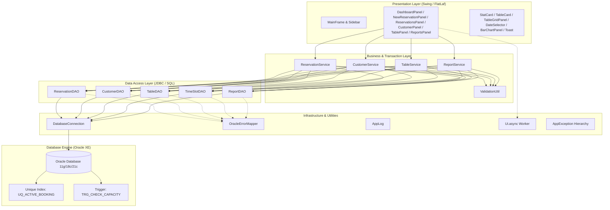
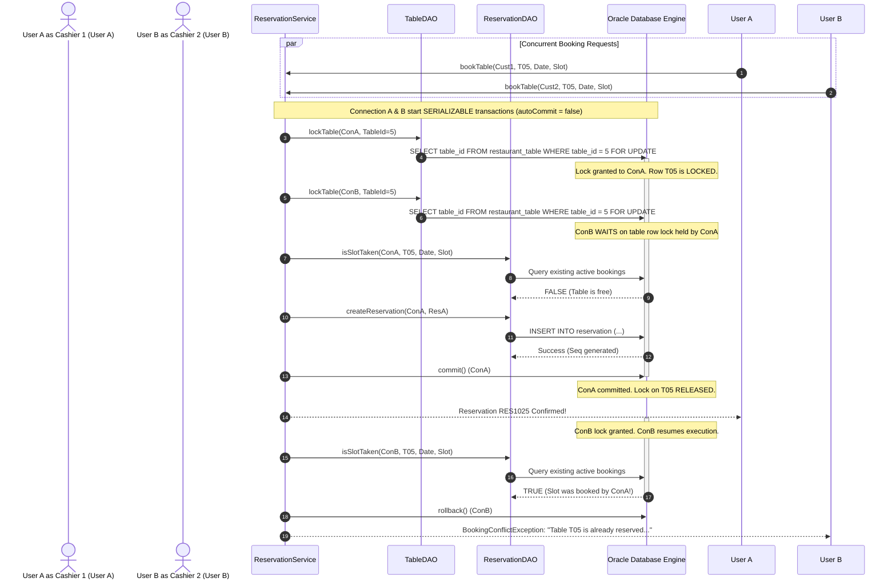

# System Architecture & Design Specification

This document details the multi-tiered architecture, threading model, and design patterns utilized in the **Restaurant Table Reservation System (RTRS)**.

---

## 1. Multi-Tier Layer Architecture

The application strictly enforces a unidirectional data flow and clean separation of concerns:
$$\text{UI Layer} \longrightarrow \text{Service Layer} \longrightarrow \text{DAO Layer} \longrightarrow \text{Database Connection} \longrightarrow \text{Oracle Database}$$

---

## 2. Layer Descriptions

### 1. Presentation Layer (`ui`, `ui.components`)
The presentation layer provides the desktop user experience built purely with Java Swing, styled with the FlatLaf Light Look-and-Feel and the Inter typography family. It consists of `MainFrame` hosting a fixed-width left navigation sidebar and a `CardLayout` content area with 6 dedicated functional panels:
- `DashboardPanel`: Metric cards, quick booking CTA, and upcoming seatings feed.
- `NewReservationPanel`: 3-step streamlined booking flow with interactive visual table layout.
- `ReservationsPanel`: Multi-criteria search, cancellation, and completion operations.
- `CustomerPanel`: Master data management with debounced live search and inline field validation.
- `TablePanel`: Table inventory CRUD and visual spatial Floor View.
- `ReportsPanel`: Tabular business intelligence with custom `Graphics2D` bar chart visualization.

**Rule:** UI classes **never** contain SQL statements and **never** import `java.sql.*`. All asynchronous DB interactions are dispatched off the Swing Event Dispatch Thread (EDT) via `Ui.async`.

### 2. Business & Service Layer (`service`, `util.ValidationUtil`)
The service layer encapsulates business logic, data validation, party-to-table capacity algorithms, and transactional boundaries:
- `ReservationService`: Implements table recommendations (`recommendTable`), slot conflict pre-checks, pessimistic row locking (`SELECT ... FOR UPDATE`), and transactional atomic commits with rollback safety.
- `CustomerService` & `TableService`: Validate domain rules and manage entity lifecycles while enforcing foreign key delete protection.
- `ReportService`: Validates analytical date intervals and coordinates operational reporting queries.
- `ValidationUtil`: Pure, unit-tested static validators collecting field-level errors into domain exceptions.

### 3. Data Access Layer (`dao`)
The DAO layer is the exclusive location where SQL queries reside. Every interaction uses `PreparedStatement` with bound parameters to guarantee SQL injection immunity. DAOs implement the `CrudDAO<T, ID>` generic interface for entity persistence and map JDBC `ResultSet` records to clean domain POJOs.

### 4. Infrastructure & Database Connectivity (`db`, `util`, `exception`)
- `DatabaseConnection`: Thread-safe JDBC factory that reads credentials securely from externalized `.env` or `config.properties` files with a 5-second connection timeout.
- `OracleErrorMapper`: Translates vendor-specific `ORA-` error codes (`ORA-00001`, `ORA-02292`, `ORA-20001`, `ORA-12541`) into friendly domain exceptions (`BookingConflictException`, `ReferenceInUseException`, `DatabaseUnavailableException`).
- `AppLog`: Configured `java.util.logging` subsystem recording system events and stack traces to `logs/app.log`.

### 5. Database Engine Layer (Oracle)
Oracle Database provides the ultimate transactional consistency and double-booking prevention via the function-based unique index `UQ_ACTIVE_BOOKING` and table triggers.

---

## 3. Concurrency & Double-Booking Prevention Model

When two users concurrently attempt to book the exact same table, date, and seating slot:

**Engine-Level Failsafe:** Even if application pre-checks or `FOR UPDATE` locks were bypassed (e.g., via direct raw SQL inserts), Oracle's `UQ_ACTIVE_BOOKING` unique index immediately raises `ORA-00001`, which `OracleErrorMapper` maps directly to `BookingConflictException`.
