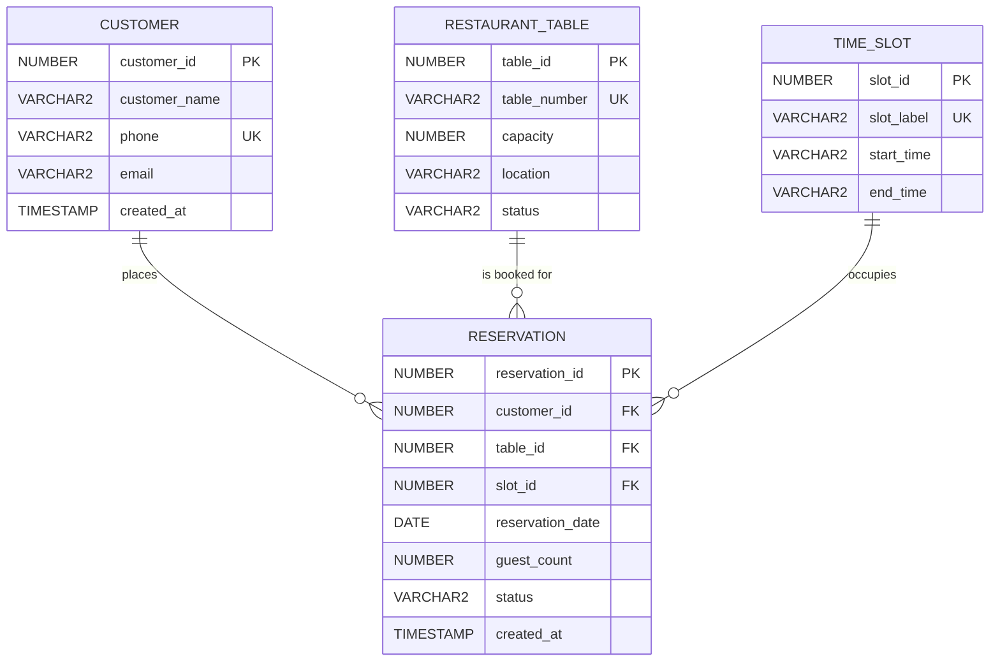

# Entity-Relationship (ER) Diagram

This document presents the visual Entity-Relationship model and relational schema definition for the **Restaurant Table Reservation System (RTRS)**, strictly matching `sql/01_schema.sql`.

---

## 1. Mermaid ER Diagram



---

## 2. Table Specifications & Constraints

### 1. `CUSTOMER`
| Column | Type | Constraints | Description |
|---|---|---|---|
| `customer_id` | NUMBER | PRIMARY KEY | Generated via sequence `customer_seq` |
| `customer_name` | VARCHAR2(100) | NOT NULL | Customer's full name |
| `phone` | VARCHAR2(15) | NOT NULL, UNIQUE (`uq_customer_phone`) | 10-digit normalised phone number |
| `email` | VARCHAR2(100) | NULL | Optional verified contact email |
| `created_at` | TIMESTAMP | DEFAULT SYSTIMESTAMP NOT NULL | Audit timestamp |

---

### 2. `RESTAURANT_TABLE`
| Column | Type | Constraints | Description |
|---|---|---|---|
| `table_id` | NUMBER | PRIMARY KEY | Generated via sequence `table_seq` |
| `table_number` | VARCHAR2(10) | NOT NULL, UNIQUE (`uq_table_number`) | Physical table identifier (e.g. T01, T02) |
| `capacity` | NUMBER(2) | NOT NULL, CHECK (`capacity BETWEEN 1 AND 20`) | Maximum seating capacity |
| `location` | VARCHAR2(30) | NOT NULL | Architectural zone (Indoor, Window, Outdoor, Hall) |
| `status` | VARCHAR2(20) | DEFAULT 'AVAILABLE' NOT NULL, CHECK (`status IN ('AVAILABLE', 'MAINTENANCE', 'INACTIVE')`) | Permanent operational state |

---

### 3. `TIME_SLOT`
| Column | Type | Constraints | Description |
|---|---|---|---|
| `slot_id` | NUMBER | PRIMARY KEY | Unique slot identifier (1 to 5) |
| `slot_label` | VARCHAR2(30) | NOT NULL, UNIQUE (`uq_slot_label`) | Human-readable seating label |
| `start_time` | VARCHAR2(5) | NOT NULL | Seating start time in 24-hr `HH:MI` format |
| `end_time` | VARCHAR2(5) | NOT NULL | Seating end time in 24-hr `HH:MI` format |

---

### 4. `RESERVATION`
| Column | Type | Constraints | Description |
|---|---|---|---|
| `reservation_id` | NUMBER | PRIMARY KEY | Generated via sequence `reservation_seq` |
| `customer_id` | NUMBER | NOT NULL, FK → `CUSTOMER(customer_id)` | Dining customer reference |
| `table_id` | NUMBER | NOT NULL, FK → `RESTAURANT_TABLE(table_id)` | Booked dining table reference |
| `reservation_date` | DATE | NOT NULL | Booking calendar date |
| `slot_id` | NUMBER | NOT NULL, FK → `TIME_SLOT(slot_id)` | Seating time window reference |
| `guest_count` | NUMBER(2) | NOT NULL, CHECK (`guest_count >= 1`) | Number of guests attending |
| `status` | VARCHAR2(20) | DEFAULT 'CONFIRMED' NOT NULL, CHECK (`status IN ('CONFIRMED', 'CANCELLED', 'COMPLETED')`) | Booking life cycle state |
| `created_at` | TIMESTAMP | DEFAULT SYSTIMESTAMP NOT NULL | Creation timestamp |

---

## 3. Engine-Level Integrity Rules

### Function-Based Unique Index (`UQ_ACTIVE_BOOKING`)
Guarantees double-booking prevention directly within the Oracle Database engine:
```sql
CREATE UNIQUE INDEX uq_active_booking ON reservation (
    table_id,
    reservation_date,
    slot_id,
    CASE WHEN status IN ('CONFIRMED', 'COMPLETED') THEN 1 ELSE NULL END
);
```

### Table Reservation Integrity Trigger (`trg_reservation_rules`)
Prevents guest count exceeding table capacity and blocks bookings on unavailable tables:
```sql
CREATE OR REPLACE TRIGGER trg_reservation_rules
BEFORE INSERT OR UPDATE OF table_id, guest_count ON reservation
FOR EACH ROW
DECLARE
    v_capacity NUMBER;
    v_status   VARCHAR2(20);
BEGIN
    SELECT capacity, status INTO v_capacity, v_status
      FROM restaurant_table WHERE table_id = :NEW.table_id;

    IF :NEW.guest_count > v_capacity THEN
        RAISE_APPLICATION_ERROR(-20001, 'Guest count exceeds table capacity');
    END IF;
    IF INSERTING AND v_status <> 'AVAILABLE' THEN
        RAISE_APPLICATION_ERROR(-20002, 'Table is not available for booking');
    END IF;
END;
/
```
